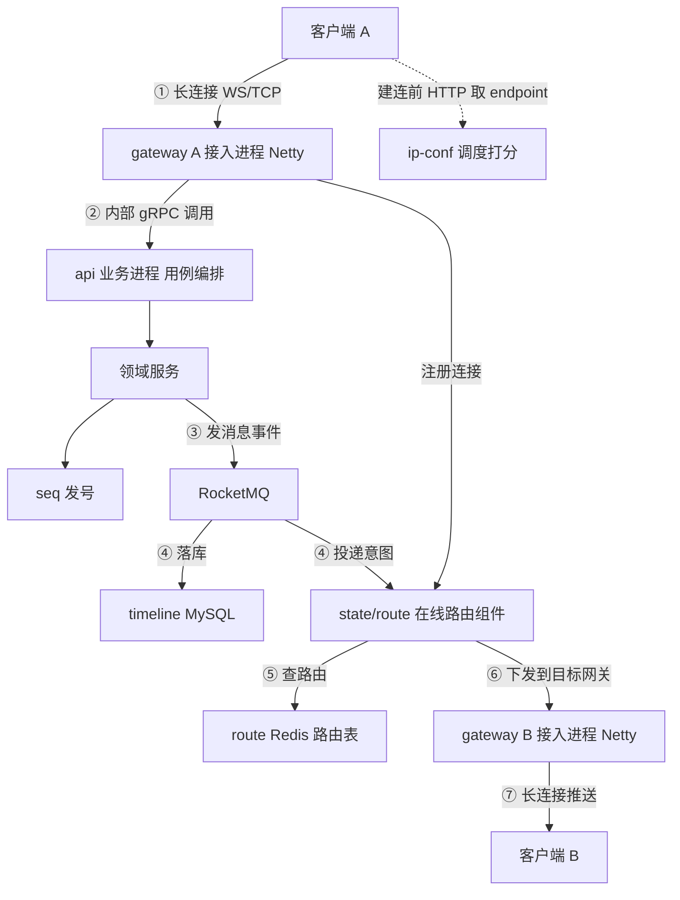
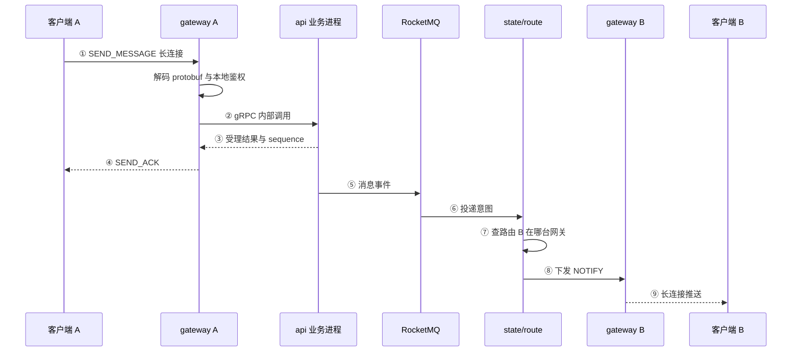
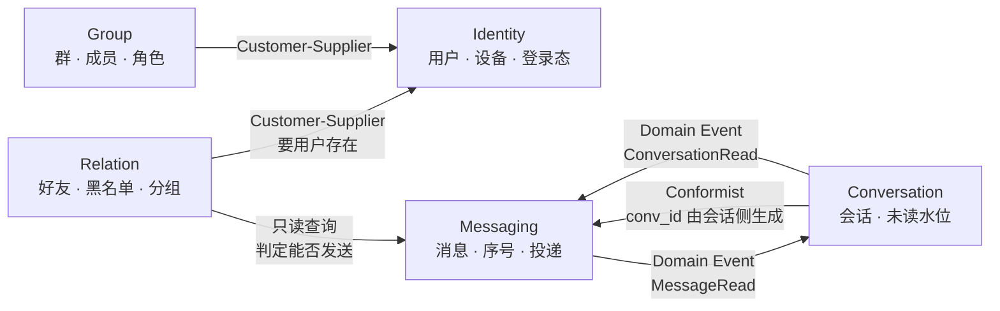
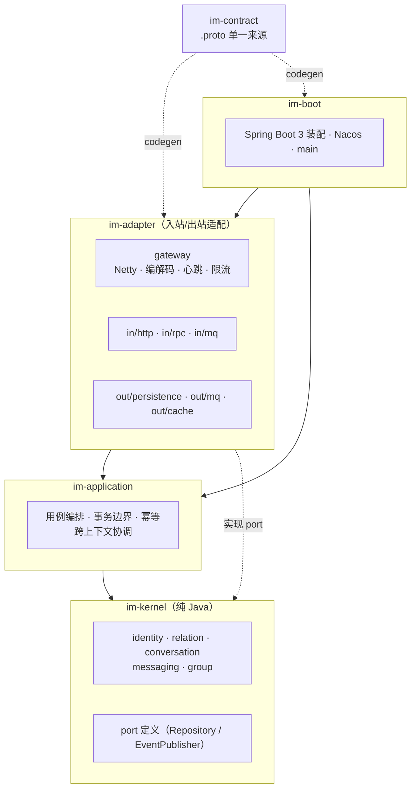
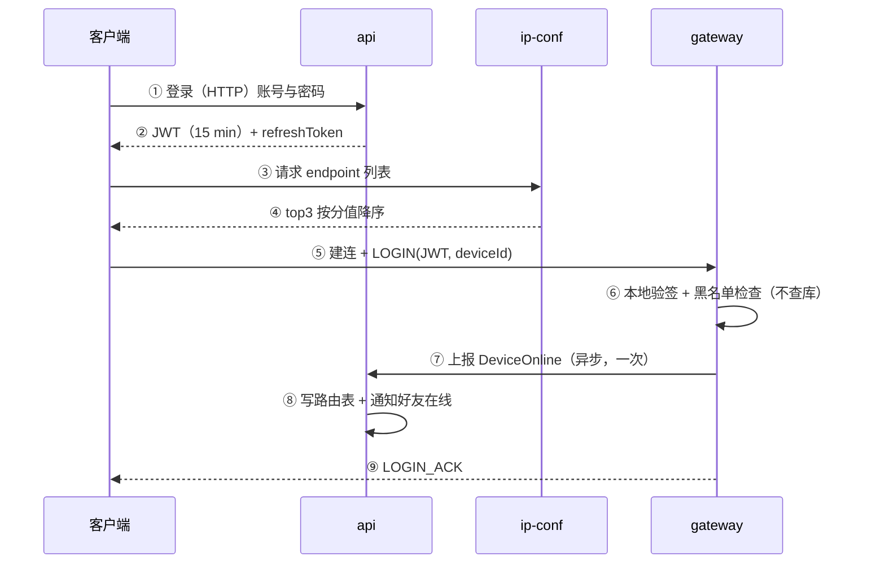
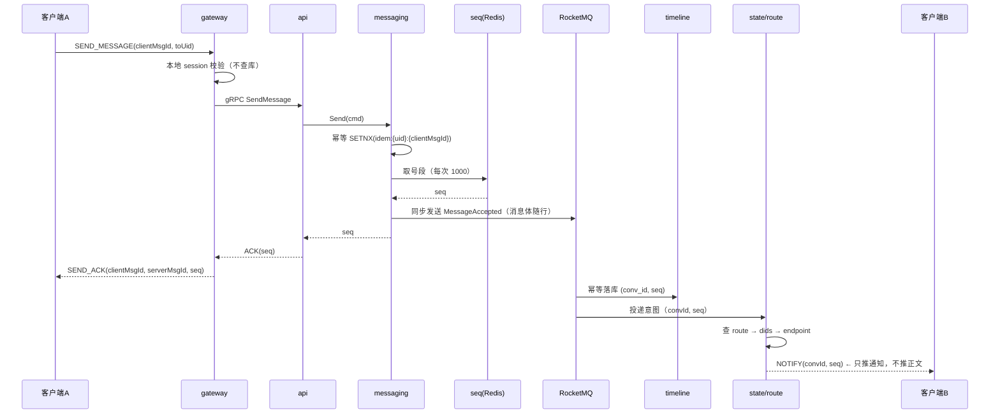
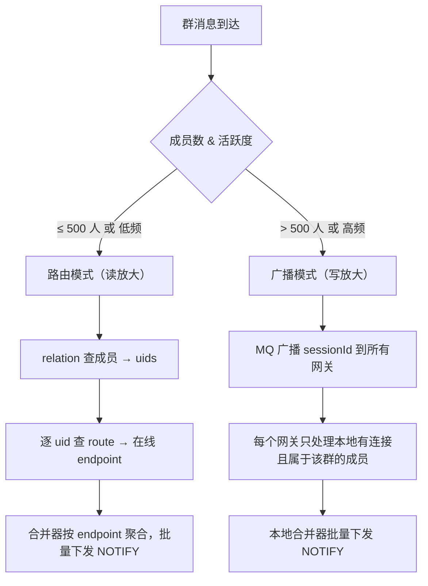
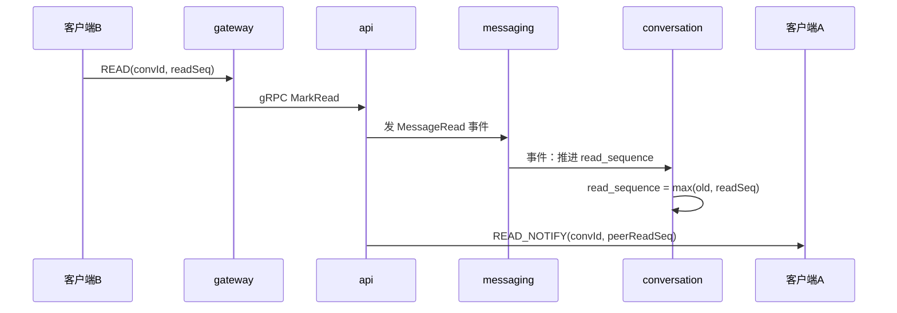
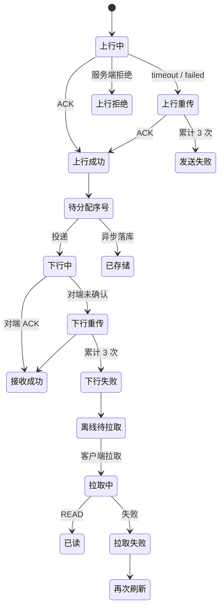

# IM v2 架构设计

> 调研来源：13 篇 IM 架构笔记（见附录 A）＋ 本仓旧实现实测 ＋ 第一期目标指标。
> 本文是**设计结论**，不是方案罗列。每条结论标注它是「照搬参考」「按规模裁剪」还是「本仓独有判断」。

---

## 0. 摘要

1. **三层四件**：接入层（调度 / 网关 / 状态路由）、业务层（应用编排 + 领域服务）、存储层（时间线 / 发号 / 计数）。接入层与业务层**必须分进程**，业务层内部**单进程多模块**。
2. **网关零业务**：只做连接、编解码、心跳、路由、限流。旧实现网关里每条消息一次 Feign 同步 RPC，是整个系统的性能天花板。
3. **投递默认读放大，大群切写放大**（组合模式）：单聊/小群走 `user → session → uids → dids → endpoint` 查路由，大群把 `sessionId` 广播给所有网关。
4. **推通知、拉内容**：服务端不缓存消息体等重传，只推「有新消息 + 最高 sequence」，客户端按 `sequence` 拉取。这是把扇出从 O(消息) 降到 O(连接) 的关键。
5. **批处理持有窗口**：合并器 `<100 条` 或 `<500 ms` 触发下发，端到端保持在 200 ms 预算内。
6. **序号由服务端按会话发号**，客户端用 `sequence` 作分页 offset 与去重依据；`messageId` 只做客户端幂等。
7. **未读数用水位（read_sequence），不用计数器**。参考实现用 counter server 是为了 5 亿 DAU 的总未读；我们的规模用计数器是纯粹的写放大。
8. **领域五个限界上下文**：Identity / Relation / Conversation / Messaging / Group。跨上下文只走领域事件。
9. **中间件四个**：Nacos（注册 + 配置）、RocketMQ（投递 + 异步落库）、Redis（路由 / 号段 / 幂等）、OceanBase（消息与关系，兼容 MySQL 协议，用分区表替代应用层分片）。**Apollo 不进**。
10. **网关不重启**：连接在内存里，重启即断线。网关与状态分离 + 优雅关闭 + 客户端错峰重连，三者缺一不可。

---

## 1. 参考材料的 18 条可复用原则

| # | 原则 | 出处 | 我们的取舍 |
|---|---|---|---|
| 1 | 接入层与业务层分离，网关职责单一、极少变更 | 网关 / IM微服务划分 | 照搬 |
| 2 | 长连接负载均衡是**持续任务调度**，不是一次哈希 | 高性能长连接网关 | 照搬（静态分/动态分） |
| 3 | 网关先看网络带宽，再退化为连接数打分 | 同上 | 照搬 |
| 4 | ip-conf 返回 top-N 列表 + 过载保护 + 客户端取 `list.next()` | 同上 / IP Config | 简化：top-3 |
| 5 | 客户端收到 FIN 不立刻重连，按需重连实现错峰 | IM Gateway | 照搬 |
| 6 | 全扇出会造成广播风暴与线程爆炸 | 连接可用性 | 照搬（组合模式） |
| 7 | 单聊/小群用路由，大群/超活跃群用广播 | 同上 | 照搬 |
| 8 | 读放大：`uid → session → uids → dids → endpoint` | 长连接中台 | 照搬 |
| 9 | 写放大：广播 `sessionId`，各网关只处理本地有连接的成员 | 同上 | 照搬 |
| 10 | 推通知、客户端拉内容（收发信箱模型） | 缓存低延迟 | 照搬 |
| 11 | 批处理持有窗口（条数 + 时间双维度） | 万人群 / 缓存低延迟 | 照搬（100 条 / 500 ms） |
| 12 | 万人群场景下**延迟优先降级为吞吐优先** | 存储模型 | 照搬 |
| 13 | 消息按时间线（Timeline）建模，`sequence` 即 offset | 存储模型 / 缓存低延迟 | 照搬 |
| 14 | 离线消息是历史消息的**缓存**，冷热分层对上游透明 | 存储模型 | 裁剪：MySQL 分片 + 归档，不用 HBase |
| 15 | 消息状态机：上行重传 / 下行重传 / 拉取失败重试，各限 3 次 | IM 架构总结 | 照搬 |
| 16 | 双 TTL（逻辑过期 + 物理过期 + 异步刷新） | 双 TTL / 缓存高可用 | 用于路由与会话元数据缓存 |
| 17 | 优雅关闭：先停止 accept，再逐个发 FIN，客户端重连成功后才断旧连接 | 平滑重启 | 照搬 |
| 18 | DDD：事件风暴 → 命令风暴 → 聚合根 → 限界上下文 | IM微服务划分 | 照搬方法论 |

**当初划掉的组件，现在要按量级重新判**（§2.1 改成 L1/L2 两层后，原来的结论不能直接沿用）：

| 组件 | L2（单机 10 万 msg/s） | L1（5 亿 DAU / PB 级） | 判定依据 |
|---|---|---|---|
| ETCD 存 ip-conf 状态 | 不采纳 | **仍不采纳** | 理由是**冗余**不是规模：Nacos 不能当高频 KV 用，但 ip-conf 也不需要独立一致性存储——各网关按秒上报分值是加法，不是事务 |
| Flink 批流一体 | 不采纳 | **部分翻案** | 未读仍用水位，所以「实时计数」不需要；但冷热迁移、扇出聚合、指标聚合在 PB 级需要流式管道——**Flink 的用途从"计数"变成"搬运"** |
| HBase / 列存存历史 | 不采纳 | **翻案** | L1 日增 PB 级，而 OB 单集群上限约 3 PB，冷数据必须落到列存/对象存储（见 §15.4） |
| 独立 counter 服务 | 不采纳 | **看产品口径** | 只给水位就不需要；若产品要求精确未读条数，L1 下必须有独立计数服务（消费消息事件 + 合并写） |
| 单体多模块 | 采纳 | **翻案** | L1 下 api / messaging / relation 三者的扩容曲线不同，必须能独立伸缩（见 §15.4） |
| gRPC 一次一条 | 采纳 | **翻案** | 750 万 QPS 下每跳一条 RPC 就是 750 万次调用/s，必须批量（见 §14 待决问题 4） |

---

## 2. 目标与边界

### 2.1 指标：分两层，别混用

**L1 设计目标**——架构按这个量级设计，但**不按这个量级压测**（参考实现的量级）：

| 维度 | L1 | 它决定了什么 |
|---|---|---|
| 用户规模 | DAU 5 亿 | 路由表规模、连接调度、单元化 |
| 峰值 QPS | 750 万 | 网关节点数、MQ 多集群、DB 分片数 |
| 端到端延迟 | p99 200 ms | 合并窗口、跨节点跳数 |
| 群规模 | 万人群 | 组合投递、推拉结合 |
| 日增存储 | 数 PB | 冷热分层、分区滚动删除 |

**L2 本轮压测目标**——一台单机，能真的打出来的数：

| 维度 | L2 | 说明 |
|---|---|---|
| 单机连接 | 100 万 | Linux 上成立；内存 1.5–3 GB，FD ≥ 110 万 |
| 单机上行 | 10 万 msg/s（峰值） | 持续按 1 万/s 设计 |
| 端到端延迟 | p99 ≤ 200 ms | 发送方发出 → 接收方 channel 写出 |
| 最大群 | 10000 人 | 群消息 ≤ 50 条/s（超过则退化为公告型） |
| 群投递 | ≤ 10 万投递/s | `群消息 QPS × 在线成员数` 必须守住这个预算 |

两层差约三个数量级。**判定标准不是"单机能不能打到 L1"，是"从 1 台扩到 N 台，吞吐是否接近线性"**——这条判据见 §15.3。选型依据统一写在 §15。

### 2.2 显式不做

- 多机房单元化、异地多活（L1 会需要，本项目不做）
- 端到端加密、阅后即焚、语音视频信令
- 消息 Holo 检索、Flink 实时分析
- 多租户物理隔离（只保留 `appId` 逻辑隔离）

### 2.3 与旧实现的差异

| 维度 | 旧实现 | v2 |
|---|---|---|
| 协议 | 28 B 上行 / 8 B 下行，JSON body | 20 B 对称帧 + protobuf |
| 网关热路径 | 每消息一次 Feign 同步 RPC + 两次 JSON 编解码 | 本地 session 判定 + 一次 MQ |
| 服务发现 | Zookeeper | Nacos |
| 投递 | RabbitMQ 扇出 | RocketMQ 分片投递 |
| 服务调用 | Feign | gRPC |
| 分层 | domain 依赖 infrastructure，模块内有 controller | 六边形，依赖倒置，ArchUnit 卡死 |
| 群扇出 | 全体成员 forEach 单发 | 组合模式（路由 / 广播） |
| 未读 | 死字段 | 水位 + 事件推进 |
| 落库 | 异常被吞，MQ 已 ack | MQ 同步发送 + 消费端幂等重投 |
| 存储 | MySQL 单库，无分区 | OceanBase 分区表（`HASH(conv_id)` + 时间二级分区） |

### 2.4 大群的四处妥协（写明，不藏在设计里）

大群不是"设计得更好"，是"用另外的东西换了成本"。四处要认账：

| 妥协 | 具体 | 不接受的代价 |
|---|---|---|
| 速率上限 | 万人群 ≤ 50 条/s，超了按公告型处理 | 做热点会话子分区路由 + 单独限流，复杂度翻倍 |
| 已读粒度 | 只给「读到哪」的水位与已读人数聚合，**不给每条消息的已读名单** | 逐条名单 = 每条消息 × 成员数 的写放大 |
| 送达语义 | 群消息不逐成员追送达确认，"已送达 N 人"只能是估算 | 每个成员一条下行 ACK，万人群一条消息 1 万次回执 |
| 实时性 | 推的是 NOTIFY（`convId + maxSeq`），正文由客户端拉 | 直接推正文，服务端要为每条消息维护重传缓存与定时器 |

注意其中哪几条**不是**降级：

- **广播模式**（>500 人走写放大）是反方向的加码——牺牲带宽换延迟，不是降级。
- **推通知拉内容**是全系统统一模型，单聊也这么走，不是大群专属。

---

## 3. 总体架构

一条消息从 A 到 B 要跨四个进程。先把四种交互分清，后面所有链路都建立在这上面：

| 谁 → 谁 | 是什么 | 为什么必须这样 |
|---|---|---|
| 客户端 → gateway | **长连接**（WS / TCP，Netty `Channel`） | 服务端要能随时推 |
| gateway → api | **内网 gRPC**（请求-响应） | 跨进程；且上行必须同步拿到返回值 |
| api / 领域 → 目标 gateway | **经 state/route 定位后投递**（MQ 或内部 RPC） | 网关有 N 台，业务侧不知道目标连接在哪台 |
| 客户端 → ip-conf | HTTP 短请求 | 只在建连前取一次 endpoint 列表 |

**「gRPC 上行」指的是第二行。** 客户端发出的字节由 gateway 的 Netty 解码成 `ChatMessage`，gateway 把这个对象交给**另一个进程**的业务层处理。它不经过客户端，也不是客户端协议。

不能"用 channel 直接连业务"：`Channel` 是客户端连接在 **gateway 进程的 EventLoop 里**的句柄，业务进程根本没有这个对象，跨进程只能走 IPC。也不用 MQ 替代这一次调用：上行要立刻知道"被拉黑 / 超发限流 / 无权限"，MQ 是单向的，给不了返回值。

**路由层不是一个可以连接的节点。** 它是「用户 X 现在连在哪台网关」这张表加一段查询逻辑，只有**下行**才用得上。客户端只连 gateway，不连路由；全双工 ws 是「客户端 ↔ gateway」那一段，不是「gateway ↔ 路由」。



同一条消息的时间顺序：



三条硬约束：

- **gateway 与 business 是两个进程**；gateway 之间无状态，唯一状态是连接本身。重启 gateway = 这批连接断，所以它要极少发版（§6.9）。
- **上行同步、下行异步**：上行走 gRPC 拿返回值；下行必须先查路由表定位节点，不许由一个 gateway 直接调另一个 gateway。
- `state/route` 初期不是独立服务，是 Redis 里的一张路由表 + 一段查询逻辑，寄宿在业务进程内；只有跨节点投递压力上来再拆。

---

## 4. 领域划分（DDD）

### 4.1 事件风暴（命令 → 事件）

| 上下文 | 命令 | 领域事件 |
|---|---|---|
| Identity | `Login` / `Logout` / `KickDevice` | `DeviceOnline` / `DeviceOffline` / `DeviceKicked` |
| Relation | `AddFriend` / `AcceptFriend` / `BlockUser` | `FriendAdded` / `UserBlocked` |
| Conversation | `OpenConversation` / `MarkRead` / `MuteConversation` | `ConversationOpened` / `ConversationRead` |
| Messaging | `SendMessage` / `RecallMessage` / `DeliverMessage` | `MessageAccepted` / `MessageStored` / `MessageDelivered` / `MessageRead` / `MessageRecalled` |
| Group | `CreateGroup` / `JoinGroup` / `LeaveGroup` / `MuteMember` | `GroupCreated` / `MemberJoined` / `MemberLeft` |

### 4.2 聚合与聚合根

| 聚合根 | 聚合内实体 / 值对象 | 不变量 |
|---|---|---|
| `Message` | `MessageId`、`Sequence`、`Content`、`Status` | 会话内 sequence 单调且不重复；已撤回不可再读 |
| `Conversation` | `ConversationId`、`Type`、`LastSequence` | `last_sequence` 只增不减 |
| `ConversationMember` | `ReadSequence`、`JoinSequence`、`Muted` | `read_sequence ≤ last_sequence` |
| `Friendship` | `FriendRequest`、`Block` | 不可自加好友 |
| `Group` | `GroupMember`、`Role` | 群主唯一；成员数 ≤ 上限 |
| `Device` | `DeviceId`、`LoginModel` | 单端登录时新设备踢旧设备 |

### 4.3 限界上下文与映射



关键点：**`MessageRead` 事件由 Messaging 发出，`Conversation` 订阅并推进 `read_sequence`**。回执是「消息被读了」，水位是「会话读到哪了」，两者分属不同聚合，否则两个聚合会互相写。

### 4.4 每个上下文不做什么

| 上下文 | 明确不做 |
|---|---|
| Identity | 不判断能否发消息（那是 Relation）、不存消息 |
| Relation | 不存会话、不认识 sequence |
| Conversation | 不存消息正文，只存序号与水位 |
| Messaging | 不维护未读计数，不查好友关系（由应用层注入判定结果） |
| Group | 不负责投递，只回答「成员是谁」 |

---

## 5. 代码分层与模块



规则（用 ArchUnit 强制）：

1. `im-kernel` 的 pom 里**不允许**出现 Spring / MyBatis / Netty / Nacos / RocketMQ 依赖。
2. `im-kernel` 不允许 import `im-adapter`、`im-application`、`im-boot` 的任何类型。
3. `im-application` 不允许 import `im-adapter`（只能依赖 kernel 的 port）。
4. 跨上下文只允许：应用层方法调用 + 领域事件；**禁止**直接 import 另一个上下文的 Repository。

可拆的三条缝：

| 缝 | 现在 | 拆服务时 |
|---|---|---|
| 网关 ↔ 业务 | gRPC | 不变（已经跨进程） |
| 跨上下文事件 | 进程内同步发布 | 换 RocketMQ 实现，业务代码不动 |
| Repository | MyBatis 实现 | 换 gRPC client 实现，接口不变 |

### 5.1 端口清单：换中间件就是换一个实现

「可替换」不是形容词，是**六个接口**。凡是会随时间被换掉的依赖，领域层只认接口，实现在 `im-adapter/out`：

| 端口 | 定义在 | 现在的实现 | 将来可能换成 | 换的时候要改什么 |
|---|---|---|---|---|
| `MessageRepository` / `ConversationRepository` | `im-kernel` | OB + MyBatis | 冷热分层后的冷存实现（列存 / 对象存储），或整体换库 | 只换实现类 |
| `SequenceAllocator` | `im-kernel` | Redis 号段 | Leaf / DB 号段 | 只换实现类 |
| `IdempotencyStore` | `im-kernel` | Redis SETNX | 数据库唯一键 | 只换实现类 |
| `RouteDirectory` | `im-kernel` | Redis 路由表 | 独立 state 服务 | 只换实现类 |
| `DomainEventPublisher` | `im-kernel` | 进程内同步分发 | RocketMQ / Kafka | 换实现 + 装配 |
| `MessageBroker` | `im-application` | RocketMQ | Kafka / Pulsar | 换实现（注意语义差异，见下） |
| `ObjectStorage` | `im-kernel` | MinIO（S3 协议） | 生产环境的对象存储（云厂商 / 自建，S3 兼容或不兼容均可） | 只换实现；非 S3 兼容则新增一个 adapter |

**明确一点：不做应用层分库分表。** 选 OB 就是为了把这件事交给数据库。这个端口存在的意义不是"将来要分表"，而是"让冷热查询能路由到不同实现"——L1 下消息按时间拆成热库（OB）与冷存（列存/对象存储），路由发生在 Repository 实现内部，业务代码无感。真要扩存储容量，扩的是 OB 集群节点，不是加一层 ShardingSphere。

三条配套规矩：

1. **领域层不认识任何中间件类型**：没有 `Jedis`、`KafkaTemplate`、`Mapper`、`@Transactional` 出现在 `im-kernel`。ArchUnit 卡死（§5 规则 1、2）。
2. **配置只出现在 `im-boot`**：`application.yml` 里的 Redis/RocketMQ 配置不许渗到业务类里，实现类通过构造器拿端口需要的参数。
3. **能力差异在适配器里抹平**：比如 Redis 的 Lua 脚本、RocketMQ 的广播消费、OB 的分区裁剪，全部封装在实现里，端口上只暴露业务语义（`allocate(convId, n)` 而不是 `incrby(key, n)`）。

### 5.2 换得掉的是接口，换不掉的是语义

诚实地说：**接口能隔掉 80%，剩下 20% 是投递语义**。

| 换什么 | 能直接换吗 | 真正的成本在哪 |
|---|---|---|
| Redis → 另一个 KV | 能 | Lua/事务语义要重写 |
| MySQL → OB | 能 | 分区键与索引策略要重定 |
| RocketMQ → Kafka | **不能无痛** | 缺广播消费、缺重投与死信，要自己补 |
| 进程内事件 → MQ | 能 | 从「同步可见」变成「最终一致」，事务边界要重划 |
| MinIO → 生产对象存储 | **多半能** | 前提是对方 S3 兼容；不兼容则只能换 adapter，端口不变 |
| 自建 Parquet 文件 → 云厂商 | 能 | 但要统一签名版本（v4）与 path-style 配置 |

所以选中间件的标准是：**要么它是能力超集，要么把用法压到公共子集**。这也是 §15.2 选 RocketMQ 而不是 Kafka 的原因——我们要的广播消费，Kafka 得自己搭。

### 5.3 什么不该抽象

过度抽象和不可替换一样是负债。判据：**只有"已经知道会换"或"已经在两个环境里跑"的东西才开端口。**

| 不该开端口 | 理由 |
|---|---|
| 领域内部的策略（比如群成员上限判定） | 没有第二个实现，加一层策略模式只是多写三个文件 |
| HTTP 序列化细节 | 框架已提供，再包一层只是转发 |
| 日志、监控的门面 | 直接用 SLF4J / OTel，包装没有收益 |
| 每个 Repository 都配一个 DTO 转换层 | 只在跨边界时才转，别为了"整洁"全量复制 |

判断标准很朴素：**如果这个接口永远只有一个实现，它就是噪音。**

---

## 6. 关键链路

### 6.1 连接建立与调度



登录走 HTTP，长连接只做验签：**网关不查 Redis、不查库**，这是 §9 里 10 µs 预算的前提。踢人靠黑名单（§ADR-0003），网关本地缓存按秒同步。

**打分模型**（照搬参考，规模上做减法）：

| 状态 | 指标 | 分值 |
|---|---|---|
| 活跃（有消息收发） | 1 s 内收发字节数，归约到 GB 保留两位小数 | 动态分，优先比较 |
| 非活跃（大量空转心跳） | 当前连接数 / 上限 | 静态分，动态分相同时比较 |

- 归约后都为 `0.00 GB` → 全部落到静态分比较。
- ip-conf 只保留上一秒分值，与当前分值求差做积分，除以置信度系数 → 计算量 O(1)、内存 O(节点数)。
- 返回 **top-3**，客户端按序重试；网关侧开启过载保护（超阈值直接拒绝）。

### 6.2 上行单聊



关键：**ACK 早于落库**。ACK 语义是"服务端已受理"，不是"已落库"。可靠性由 RocketMQ 同步发送 + 消费端幂等保障，不靠同步写库。

### 6.3 群聊：组合模式



判定阈值可配置（`group.broadcast.threshold=500`），大群清单放 Redis，避免每条群消息都去数成员。

广播模式直接用 RocketMQ 的**广播消费**（同一 Group 下每个消费者实例都收到全量消息）；顺序性用**分区顺序消息**，sharding key = `convId`。

### 6.4 下行投递与合并

- 服务端只推 `NOTIFY { convId, maxSeq }`，**不推消息体**。
- 客户端收到 NOTIFY 后按 `sequence` 增量拉取，拉取走 HTTP（可批量、可分页、可缓存）。
- 合并器：同一连接 500 ms 内、或积攒 100 条 NOTIFY → 立刻合并成一条下发。
- 为什么推内容不是默认：服务端要为每条消息维护定时器与缓存以便重传，占内存还占线程；推通知后，重传归客户端拉取逻辑处理，服务端无状态。

### 6.5 已读与未读



- **未读数 = `last_sequence − read_sequence`**，服务端不存计数。
- 群聊的"已读人数"单独建模：`conversation_member.read_sequence` 上做聚合查询，不做每条消息的已读名单。
- 如果产品坚持要精确未读条数，再加一条独立的 counter 投影（消费 `MessageAccepted`），**但不能放在主链路里**。

### 6.6 离线与历史

- 消息只存一份（时间线），按 `conversationId` 分片，主键 `(conv_id, seq)`。
- 拉取接口：`GET /messages?convId&fromSeq&limit`，`sequence` 即 offset，支持双向翻页。
- 离线 = "登录后对每个会话取 `read_sequence` 之后的部分"，不需要写入时给每个成员写离线箱。**这一点与参考实现的 `offline_msg:u:{uid}` zset 不同**：那个结构在万人群场景下每条消息要写 1 万次，我们不用。
- 冷热：30 天内表内，之后归档到 `message_archive`（同构表），查询路由按 `seq` 时间范围判断。

### 6.7 撤回

- `RecallMessage` → 写一条 `RECALL` 类型的消息（不可变追加），不物理删除。
- 客户端按 `messageId` 覆盖本地展示。
- 离线用户拉取时自然拿到撤回记录，**不需要修改离线缓存**（参考实现担心的"写放大"在时间线模型里不存在）。

### 6.8 心跳、断连与重连

| 项 | 设计 |
|---|---|
| 心跳周期 | 30 s（服务端读空闲 90 s 判定超时） |
| 心跳处理 | 纯本地，不查 Redis、不写日志、不打点 |
| 断连判定 | `IdleStateHandler(READER_IDLE)` + `HashedWheelTimer`，O(1)/事件 |
| 重连 | 客户端收到 FIN **不立即重连**，等下次有消息要发或 5 s 后随机退避重连（错峰） |
| 踢下线 | 服务端踢人时下发 `KICK` 而非直接 close，客户端主动断开且不立刻重连 |

### 6.9 平滑重启

1. 网关摘除注册（Nacos），停止 accept 新连接。
2. 向所有连接下发 `SERVER_DRAIN`（不是直接 FIN）。
3. 逐批关闭 fd，客户端收到后向 ip-conf 重新取 endpoint、建新连接。
4. 新连接建立成功后才断旧连接。
5. 旧连接表清空后进程退出。

---

## 7. 消息状态机



- 三次重传后仍未成功：标记 `离线待拉取`，交给拉取链路兜底，**不丢**。

### 7.1 三个标识，各管一件事

一条消息从产生到被引用，需要三个互不替代的标识：

| 标识 | 谁生成 | 用途 | 缺了它会怎样 |
|---|---|---|---|
| `clientMsgId` | 客户端，重传不变 | 定位"哪条还没收到 ACK"；服务端幂等去重；重发仍是同一条 | 超时后不知道重传哪条；重发产生重复消息 |
| `serverMsgId` | 服务端，雪花 64 位 | **全局唯一身份**：撤回、引用回复、已读回执、审计、日志、跨系统引用 | 只能用 `(conv_id, seq)` 两段定位，且 `seq` 有号段空洞、会泄露会话内消息总量 |
| `sequence` | 服务端，按会话发号 | **顺序**：排序、增量拉取 offset、客户端去重 | 无法判断先后，无法增量拉取 |

三者职责边界：

- `clientMsgId` **不能**用来排序——不同设备、不同时钟生成，既无序也不保证唯一。
- `serverMsgId` **不能**用来排序——雪花按时间递增只是近似，跨毫秒会跳，且时钟回拨要靠生成器兜住。
- `sequence` **不能**当全局身份——它只在会话内唯一，还带号段空洞，而且是对外可见的"这个会话有多少条消息"。

**寻址仍需要会话上下文**：`serverMsgId` 是身份不是地址。撤回、引用这类接口必须带 `convId + serverMsgId`，因为消息按 `convId` 分片存储，只给一个雪花 id 无法定位到分片。这是分片带来的代价，不是设计缺陷。

`serverMsgId` 由业务进程本地生成（雪花），**不走 Redis、不走 RPC**，热路径零网络往返。`workerId` 由部署配置从 Nacos 下发（10 位，最多 1024 个实例），时钟回拨超过阈值就拒绝发号并告警，不靠等待硬扛。

---

## 8. 存储设计

### 8.1 Redis

| 用途 | Key | Value | 过期 |
|---|---|---|---|
| 在线路由 | `route:u:{uid}` | `pb{deviceId → nodeId}` | 连接断开时删 |
| 节点连接数 | `route:n:{node}` | `hash{uid → deviceBit}` | 随连接 |
| 号段 | `seq:seg:{convId}` | `int64`（INCRBY 1000） | 无 |
| 幂等 | `idem:{uid}:{clientMsgId}` | `sequence` | 10 min |
| 大群成员 | `group:members:{gid}` | `pb(memberList)` | 30 min |
| 关系判定 | `rel:{uid}` | `pb{friends, blocks, groups}` | 30 min，事件失效 |

### 8.2 OceanBase（消息与会话）

用 OB 的分区表替代应用层分片：**代码里不再有 16 片路由**，分区与裁剪交给数据库。开发环境用 OB 社区版单机（兼容 MySQL 协议），MyBatis 与 SQL 不用改。

选它的三条理由，按重要性排：

1. **分区裁剪**——消息唯一的访问模式是「按会话取一段 sequence」，`WHERE conv_id = ? AND seq BETWEEN ? AND ?` 命中 `PARTITION BY HASH(conv_id)` 后只扫一个分区。
2. **局部唯一索引必须包含分区键**——幂等键正好设计成 `(conv_id, from_uid, client_msg_id)`，天然满足，不用为建索引去改分片键。
3. **多副本强一致**——不用再维护 MySQL 主从切换那一套。

**为什么不直接建一张不分区的大表**（这条容易被"OB 单表能存十几亿"带偏）：

- OB 的单表行数**确实没有硬上限**，官方《使用限制》写的是"行数无限制"；社区经验值是不超过 10 亿行 / 2000 GB 可以不分区，但官方《存储 FAQ》给的是更严的一条：**预计突破 200 GB 就建议分区**。两个数字差一个数量级，取严的。
- 更关键的是机制：**非分区表在 OB 里就是一个分区，只有一个 leader 副本**，读写全落在一台机器上。分区是 OB 做分布式的最小单位——**不分区就等于放弃了水平扩展**，只剩单机能力。
- 行数本身不是性能杀手（官方 FAQ：100 万行和 100 亿行用索引找行都是三次二分查找）。真正的杀手是**单分区承载的写入并发与体积**：我们的写入是 10 万/s 且随机（不同会话交替插入），单 leader 会成为唯一瓶颈。
- OB 的自动分区分裂（`enable_auto_split`，V4.3.4+，默认关闭）**只支持 Range 一级分区**，不支持 Hash、不支持二级分区——我们的 `HASH(conv_id)` + 时间二级分区正好都在不支持列表里，所以只能手工规划。

结论：分区在这里不是为了"存得下"，是为了**写得开（多 leader 分散写入）、裁得掉（按会话只扫一片）、删得掉（`DROP PARTITION` 秒级归档）**。

```sql
-- 消息（唯一真相）
CREATE TABLE message (
  conv_id       BIGINT      NOT NULL,
  seq           BIGINT      NOT NULL,
  server_msg_id BIGINT      NOT NULL,      -- 雪花，全局身份
  client_msg_id VARCHAR(64) NOT NULL,      -- 客户端幂等键，重传不变
  from_uid      BIGINT      NOT NULL,
  type          TINYINT     NOT NULL,      -- 0 text / 1 image / 2 file / 3 recall
  payload       BLOB        NOT NULL,
  created_at    BIGINT      NOT NULL,
  PRIMARY KEY (conv_id, seq),
  UNIQUE KEY uk_msg (conv_id, from_uid, client_msg_id),
  UNIQUE KEY uk_server_msg (server_msg_id) GLOBAL
) PARTITION BY HASH(conv_id) PARTITIONS 16;

-- 会话（只存元数据与水位锚点）
CREATE TABLE conversation (
  conv_id      BIGINT PRIMARY KEY,
  type         TINYINT NOT NULL,
  last_seq     BIGINT  NOT NULL DEFAULT 0,
  updated_at   BIGINT  NOT NULL
) PARTITION BY HASH(conv_id) PARTITIONS 16;

-- 单聊的"一对用户只允许一个会话"约束：分区表做不到全局唯一，所以单独一张小表
CREATE TABLE single_conversation (
  app_id       INT    NOT NULL,
  uid_a        BIGINT NOT NULL,           -- 约定 uid_a < uid_b，双方算出的顺序一致
  uid_b        BIGINT NOT NULL,
  conv_id      BIGINT NOT NULL,
  created_at   BIGINT NOT NULL,
  PRIMARY KEY (app_id, uid_a, uid_b)
) PARTITION BY HASH(uid_a) PARTITIONS 8;

-- 会话成员与已读水位：与消息同分区，水位推进和落库能落在一个单机事务里
CREATE TABLE conversation_member (
  conv_id      BIGINT NOT NULL,
  uid          BIGINT NOT NULL,
  read_seq     BIGINT NOT NULL DEFAULT 0,
  join_seq     BIGINT NOT NULL DEFAULT 0,
  muted        TINYINT NOT NULL DEFAULT 0,
  PRIMARY KEY (conv_id, uid),
  KEY idx_uid_conversation (uid, conv_id)
) PARTITION BY HASH(conv_id) PARTITIONS 16;
```

**为什么单聊要多一张 `single_conversation`**：分区表的唯一索引必须包含分区键，所以 `conversation` 上做不出「(app_id, uid_a, uid_b) 全局唯一」——这是 OB 的规则，不是偷懒。解决办法是把这条约束放到一张**按 `uid_a` 分区、主键天然唯一**的小表上，建会话时先查/插这张表拿 `conv_id`，再写 `conversation`。代价是一次额外的写，好处是 `conversation` 表可以放心按 `conv_id` 分区。

**`uk_server_msg` 是一个真取舍，不是白拿的**：

- 建全局唯一索引 → 撤回、引用只给 `serverMsgId` 就够，碰撞也由数据库兜底，不靠生成器自证；
- 代价是每条消息多一次跨分区的全局索引写，10 万/s 下是实打实的放大；
- 压测不达标就退回：去掉全局索引，引用接口要求 `convId + serverMsgId`（客户端本来就有会话上下文）。

**读一致性红线**：消息读写一律强一致读。禁止 `READ_CONSISTENCY(WEAK)` hint、禁止 `obproxy_read_consistency=1`。OB 读默认走 leader，弱读会路由到 follower，刚提交的行读不到——「发完立刻拉」会直接漏消息。这个坑在别的业务上踩过，不再踩第二次。

**冷热**：消息表按 `created_at` 做二级时间分区（模板子分区，具体语法落地时验证），过期分区 `DROP PARTITION` 即可，不需要应用层归档作业。查询始终带 `conv_id`，先裁剪到一级 HASH 分区再按时间扫。

其它表：`im_user`、`im_device`、`im_friend`、`im_friend_request`、`im_group`、`im_group_member`。

### 8.3 发号

两个号码，两种机制，不要混：

| 号码 | 机制 | 位置 | 约束 |
|---|---|---|---|
| `serverMsgId` | 雪花（41 位时间 + 10 位 workerId + 12 位序列） | 业务进程本地 | 全局唯一、近似递增、**零网络调用** |
| `sequence` | Redis 号段 `INCRBY ... 1000` + 进程内自增 | 按会话 | 会话内严格单调，允许空洞 |

- `workerId` 由 Nacos 配置下发，部署时唯一分配；集群超过 1024 个实例再换 Leaf 之类的分段方案。
- 时钟回拨超过阈值（比如 5 ms）直接拒绝发号并告警，不阻塞等待——IM 宁可让这条消息失败重试，也不要卡住整个 EventLoop。
- Redis 号段：进程重启丢弃未用完的号 → 产生**空洞但不回退**。`sequence` 的语义是"先后"不是"连续"，空洞无副作用。
- 单调性由"每个 convId 的号段单点递增"保证；跨会话无全局顺序需求。

### 8.4 冷热分层（L1 才启用，现在只定边界与接口形状）

L2 用不到这一节：单机压测的量级下，热表几 TB 就装完了。它的触发条件是 **L1 的日增 PB 级**，但现在必须定下来，因为**接口形状定错了以后改不动**。

| 维度 | 决定 | 理由 |
|---|---|---|
| 冷热边界 | **按时间，默认 30 天，可配** | `sequence` 只在会话内单调，跨会话比不了；`created_at` 才是全局时间轴 |
| 介质 | **对象存储（OSS）+ Parquet**，配一个外部查询引擎 | 音视频本来就要落 OSS，同一套存储、同一套生命周期策略；Parquet 压缩率高，冷数据成本最低 |
| 迁移方式 | **分区级搬迁**（`DROP PARTITION` / 导出后再 DROP），不逐行搬 | 逐行搬 86 亿条要跑几天，分区级是秒级 |
| 查询路由 | 在 `MessageRepository` **实现内部**按 `created_at` 判定，跨边界时两次查询再按 `seq` 合并 | 业务代码只看到 `range(convId, from, to, limit)` |
| 跨边界排序 | **禁止**跨边界做全局排序或聚合 | 要把冷热两段全拉回内存，等于把冷数据的成本又付一遍 |
| 删除与合规 | 分区级删除 + 墓碑表（记录被单独删除的 `serverMsgId`） | "删一条消息"不能靠改冷存文件 |
| 延迟 SLA | 热 p99 ≤ 10 ms，冷 p99 ≤ 800 ms | OSS 单次 GET 就要 10–50 ms，加上查询引擎调度，200 ms 不现实；改为异步/骨架屏体验 |

接口形状（现在就照这个写，将来只换实现）：

```java
public interface MessageRepository {
    List<Message> range(long convId, long fromSeq, long toSeq, int limit);
    Optional<Message> byServerMsgId(long convId, long serverMsgId);
}
```

两条纪律：

1. **查询必须带 `convId`**：冷存没有按用户、按关键词的索引，跨会话扫冷存是不可接受的。要全文搜索就去 ES，不要指望冷存。
2. **冷存只读**：撤回不改冷数据，写一条 `RECALL` 追加在热表（§6.7）；墓碑表负责对已归档消息的隐藏。

**为什么不是 HBase**（这是个真问题，给结论和条件）：

| 维度 | HBase | 我们这个场景 |
|---|---|---|
| 写吞吐 | 极强，LSM 顺序写 | **冷数据只读，写优势用不上** |
| 访问模式 | 按 rowkey 范围扫，`convId+seq` 正好匹配 | ✅ 匹配，但列存/对象存储也能做 |
| 二级索引 | **没有**，`serverMsgId → (convId, seq)` 要自建索引表或 Phoenix | ❌ 撤回/引用会变贵 |
| 事务 | 只有单行；跨行一致性自己做 | ❌ 会话水位与消息落库要自己兜 |
| 运维 | 依赖 HDFS + ZooKeeper + RegionServer | ❌ 刚把 ZK 从架构里删掉，再引回来自相矛盾 |
| 延迟长尾 | compaction / split / region 迁移造成毛刺 | ❌ 与 p99 200 ms 的承诺冲突 |
| 成本 | 存储便宜 | ✅ 唯一明确优势 |

**会改选 HBase 的条件**：热数据写入量远超单集群 OB 的上限（比如持续百万级 msg/s）、且只需要按 rowkey 访问、且团队已有 HBase 运维能力。三条同时成立才值得——现在一条都不成立。

反过来，HBase 最擅长的是"高并发写 + 只按 key 取"，我们把冷数据做成了只读，等于主动放弃了它的主场。

#### 8.4.1 冷存落地形态：OSS + Parquet

**Parquet 是什么**：列式文件格式。同一列的值连续存放，带行组统计（每列 min/max），压缩率高（同类型数据相似度高），schema 内嵌在文件里，**写一次不再修改**。它不像数据库那样有索引，跳过无关数据的唯一手段是"少读文件 + 靠行组统计下推"。

所以**文件布局决定了查询成本**：

```text
msg/cold/conv_bucket=037/date=2026-10-01/part-0001.parquet
```

- `conv_bucket = hash(conv_id) % 1024`：一个会话的文件只落在 1 个 bucket 目录下，查询只需扫这一个前缀；
- `date=YYYY-MM-DD`：配合生命周期与整日删除；
- 文件内按 `seq` 升序，行组目标 128–512 MB。

三个必须提前认的问题：

| 问题 | 现象 | 对策 |
|---|---|---|
| 小文件 | 海量小会话每天各出一个文件，元数据与 GET 次数爆炸 | 合并作业：按 `conv_bucket + date` 定期改写为 512 MB |
| 请求成本 | OSS 按 GET 计费，一次查询可能触发多次 GET | 缓存文件尾部块（本地/Redis），同会话二次读命中 |
| 延迟 | 首字节 10–50 ms，加引擎调度 | 冷读 SLA 放宽到 800 ms，前端用骨架屏；**不进同步热路径** |

查询引擎三选一：

| 方案 | 适合 | 代价 |
|---|---|---|
| **DuckDB** | 嵌入式，单机直接查 Parquet，零运维；后台/运维脚本 | 不适合多实例高并发在线查询 |
| Trino | MPP，运营后台多用户 | 要独立集群，运维重 |
| ClickHouse + S3 表函数 | 在线冷读，并发与延迟较好 | 多一套系统 |

**一期建议**：DuckDB 跑离线与后台查询，在线冷读先靠"延长 OB 热窗口"顶着；真需要在线冷读时再评估 Trino / ClickHouse。

与音视频共用 OSS：同 bucket 不同前缀——`msg/`（Parquet）与 `media/`（原始文件），生命周期分开配。

### 8.5 对象存储：按 S3 协议抽象，本地用 MinIO 顶

对象存储是第二个会换的依赖（本地 MinIO → 生产 OSS），所以和数据库一样只认端口：

```java
public interface ObjectStorage {
    void put(ObjectKey key, InputStream body, long length, String contentType);
    Optional<ObjectRef> get(ObjectKey key);              // 只返回业务需要的元数据
    boolean delete(ObjectKey key);
    List<ObjectRef> list(ObjectPrefix prefix, int limit);
    String presign(ObjectKey key, Duration ttl);         // 客户端直传/直读
    String multipartInit(ObjectKey key, String contentType);
    PartResult uploadPart(ObjectKey key, String uploadId, int partNo, InputStream body, long length);
    void multipartComplete(ObjectKey key, String uploadId, List<PartInfo> parts);
}
```

三条抽象原则：

1. **不暴露 SDK 类型**：端口上没有 `S3Object`、`RequestBody`、`PutObjectResponse`，只有 `ObjectKey` / `ObjectRef` / `PartInfo` 这些自己的值对象。
2. **key 由应用层构造**：`ObjectKey.of("msg/cold", "conv_bucket=037/date=2026-10-01/part-0001.parquet")`，adapter 只负责映射路径与鉴权，不决定布局。
3. **配置只在 `im-boot`**：`endpoint / region / accessKey / secretKey / bucket / pathStyleAccess` 全部来自配置，实现类构造器注入。

**换实现会踩的 S3 语义差异**：

| 差异 | 影响 | 对策 |
|---|---|---|
| path-style vs virtual-host | MinIO 默认 path-style，S3/部分云默认 virtual-host | 配置项 `pathStyleAccess`，不写死 |
| 签名版本 | v2 / v4 混用会 403 | 统一 v4 |
| multipart 最小分片 | 除最后一片外不得小于 5 MiB | 分片固定 8–16 MB |
| list 一致性 | 旧版 S3 的 list 是最终一致，MinIO 强一致 | 不依赖"写完立刻 list 到"，用写入返回的 ETag |
| presign 有效期 | 各厂商上限不同（1 h ~ 7 d） | 端口内做上限裁剪，业务传 `Duration` |

**本地开发**：`docker compose up -d im-minio im-minio-init` 起 MinIO（API `:9000`、控制台 `:9001`），初始化容器建 `im-msg` 与 `im-media` 两个 bucket。生产替换只需改配置，代码不动。

**一个必须提前确认的前提**：生产环境最终用哪个对象存储，现在不用定。判断它能不能直接复用的方法只有一条：**能不能把 AWS S3 SDK 指向它的 endpoint 跑通 put/get**。能，就只改配置；不能，就新写一个 adapter（大约一两百行），端口和业务代码都不动。所以 `ObjectStorage` 的方法签名只用 S3 的**基础语义**（put/get/delete/list/presign/multipart），不掺任何厂商特性。

---

## 9. 性能预算

| 跳 | 预算 |
|---|---|
| 客户端 → 网关（同城） | 10–30 ms |
| 解码 + 本地鉴权 | < 0.1 ms |
| 网关 → api（gRPC 内网） | 1–2 ms |
| 取号段（本地命中） | ~0（1/1000 次走 Redis） |
| api → MQ 投递 | 1–3 ms |
| MQ → 投递消费者 → 目标网关 | 3–10 ms |
| 合并窗口 | 0–500 ms（P99 取 500） |
| 目标网关写出 | < 1 ms |
| **合计 p99** | **≈ 60–120 ms + 合并窗口** |

10 万 msg/s 单机预算：每消息 10 µs。硬约束三条：

1. 热路径不许有 Redis / RPC 往返。
2. 不许重复序列化（旧实现每条消息两次 JSON 编解码）。
3. 出站用 `FlushConsolidationHandler`，避免每条消息一次 flush 系统调用。

**Disruptor 的结论**：现在不用。Netty EventLoop 已经按连接无锁串行；跨线程交接先用"有界 MPSC + 批量 poll + 按 convId 分区"。等压测火焰图显示队列竞争进前三再换。

**虚拟线程的结论**：EventLoop 用平台线程（Netty 官方立场：event loop 是 CPU 密集轮询，虚拟线程只增加调度开销）。虚拟线程只用在"必须阻塞"的地方，例如独立的历史消息查询线程池——而且不能出现在消息热路径上。

---

## 10. 可靠性

| 风险 | 对策 |
|---|---|
| MQ 发送成功但落库失败 | RocketMQ 自动重投；消费端按 `(conv_id, seq)` 幂等，重复写无副作用 |
| MQ 重复投递 | 消费端按 `(convId, seq)` 天然幂等 |
| 序号回退 | 号段只增不减；Redis Lua 校验单调 |
| 网关宕机 | 客户端重连 + 错峰；会话状态在业务层，网关无状态可换 |
| 消息重复发送 | 客户端 `clientMsgId` + 服务端 SETNX 10 分钟窗口 + 分区内 `uk_msg` 唯一索引兜底（SETNX 过期后仍不会写出两条） |
| `serverMsgId` 碰撞 | 雪花 `workerId` 部署唯一 + 时钟回拨拒绝发号；全局唯一索引在库上再兜一层 |
| OB 弱读导致写后读不到 | 强制强一致读；禁用 `READ_CONSISTENCY(WEAK)` 与 `obproxy_read_consistency=1`；e2e 必须有"发完立刻拉"用例 |
| 投递丢失 | 三次重传后落"离线待拉取"，由拉取链路兜底 |
| 缓存不一致（关系） | 事件驱动失效 + TTL 30 min 兜底；允许秒级窗口 |

---

## 11. 可观测性

必须有的指标（每个都要有对应的排查路径）：

- 连接：当前连接数 / 节点、新建速率、异常断开率、心跳超时率
- 上行：QPS、p99 耗时、拒绝率、幂等命中率
- 下行：投递 QPS、合并率（实际下发 / 收到 NOTIFY）、投递失败率
- 端到端：发送 → 对端写出延迟 P50/P99
- 存储：落库延迟、MQ 消费 lag、重投次数、号段剩余
- 容量：FD 使用率、堆外内存、GC pause、网络带宽

---

## 12. 测试策略

| 层 | 内容 | 何时跑 |
|---|---|---|
| 领域单测 | 聚合不变量、状态机迁移、发号空洞 | 每次提交 |
| 契约测试 | proto 变更后 Java 与 TS 双端编译 + 反序列化互通 | 每次提交 |
| e2e 冒烟 | docker compose 起全套 + 两个假客户端：登录、互发、ACK、回执、拉取 | 每次提交 |
| 压测 | 百万连接模拟器 + 10 万 QPS 压测 | 手动，Linux 机器，出报告 |

压测侧两个硬约束（不在服务端，在压测机）：

- 单客户端 IP 的可用源端口有限：Linux 默认 `ip_local_port_range` 约 2.8 万（可调到 6 万），macOS 只有 16384。模拟 100 万连接需要多 IP（`lo0` 别名 / 多网卡）或服务端监听多个端口；
- 服务端与压测端都要调 `ulimit -n`、`fs.file-max`、`net.core.somaxconn`、`net.ipv4.tcp_max_syn_backlog`，否则压出来的只是内核限制，不是架构上限。

**本机（macOS）能压到哪**——这台机器：Apple M5，10 核（4P+6E），16 GB。硬限值是实测的：

| 瓶颈 | 实测值 | 后果 |
|---|---|---|
| 每进程 FD 上限 | `kern.maxfilesperproc = 61440` | **单进程最多约 6 万连接**，这是硬顶 |
| 系统 FD 上限 | `kern.maxfiles = 122880` | 压测端 + 服务端加起来也在这个池子里 |
| 临时端口 | `49152–65535` = 16384 个 | 单源 IP 到单端点最多 16384 连接，再多要给 `lo0` 加别名或多端口监听 |
| accept 队列 | `kern.ipc.somaxconn = 128` | 突发建连会丢 SYN，压测前必须调大 |
| 内存 | 16 GB，其中 colima 占 8 GB | 中间件跑在 VM 里，会和压测端抢资源 |

按这些值外推，本机能稳定压出来的量级：

| 场景 | 估计上限 | 说明 |
|---|---|---|
| 空闲长连接 | **2–3 万**（硬顶 6 万） | FD 与端口双限，再加 lo0 别名也难稳定 |
| 纯 echo 吞吐 | 10–20 万 msg/s | 收发同机，共享 10 核 |
| 含 protobuf + 业务 2 跳 | **3–5 万 msg/s** | 压测端吃掉约一半 CPU |

所以本机的定位是：**跑功能 e2e + 小规模冒烟（1 万连接 / 1 万 msg/s）+ 采集单条成本**，不是跑 L2 的 100 万连接。

**外推方法**（这才是本机压测的真正产出）：

1. 压测时采集两个数：**每连接常驻内存**（RSS 增量 ÷ 连接数）与**每消息 CPU**（CPU 时间 ÷ 消息数）；
2. Linux 连接上限 ≈ `min(ulimit -n, 物理内存 / 每连接 KB, 心跳 CPU 预算)`；
3. Linux 吞吐 ≈ `核数 × 10⁶ / 每消息 CPU(µs) × 0.6`（0.6 是工程系数，扣掉调度与内存带宽损耗）；
4. 这两个系数一旦测准，L2 的 100 万 / 10 万每秒可以在 Linux 上直接验证，而不是在笔记本上猜。

---

## 13. 演进路线（垂直切片）

| 步 | 交付 | 验收 |
|---|---|---|
| 1 | `im-contract` + `im-kernel` 骨架 + ArchUnit | `mvn verify` 通过，依赖方向被卡住 |
| 2 | 登录 → 心跳 → 断开（含网关与 Nacos 装配） | 两个假客户端能连上并保持 |
| 3 | 单聊上行 → 取号 → MQ → 幂等落库 → ACK | e2e：A 发 B 收，DB 有记录 |
| 4 | 下行投递（route + NOTIFY）+ 客户端拉取 | e2e：离线后上线能拉到 |
| 5 | 已读回执 + 水位 + 未读数 | e2e：B 读后 A 收到回执 |
| 6 | 群聊（组合模式）+ 合并器 | e2e：500 人群，投递数符合预期 |

每步都必须同时产出：Java 服务端、proto 契约变更、SDK 对应方法、前端可跑的交互。

---

## 14. 待决问题

分成三组：**不拍板就会返工的**、**我可以先按默认做的**、**能等的**。

### 14.1 已定（2026-10-29）

| # | 问题 | 结论 | 理由 | 记录 |
|---|---|---|---|---|
| A1 | 本地开发用什么跑 SQL | **OB 社区版单机容器** | 分区表与全局索引是设计核心，用 MySQL 开发等于把要验证的东西全推后 | §8.2 |
| A2 | 单聊 `convId` 怎么生成 | **独立会话表分配** | 哈希方案锁死"删好友再加是否延续历史"这类产品问题；会话表只是一次 insert + 唯一约束 | ADR-0001 |
| A3 | 登录鉴权形态 | **JWT（15 min）+ 刷新 token + 踢人黑名单** | 唯一同时满足「网关零查库」与「能踢人」的组合；纯 Redis session 会让每条消息多一次往返 | ADR-0003 |

原来的选项对比（保留作决策依据）：

| # | 问题 | 选项 | 影响面 |
|---|---|---|---|
| A1 | 本地开发用什么跑 SQL | OB 社区版单机容器 / 先 MySQL 后切 OB | DDL 方言、分区语法、全局索引能不能本地验；**影响第一批迁移脚本** |
| A2 | 单聊 `convId` 怎么生成 | 双 uid 规范化哈希（`hash(min,max)`）/ 独立会话表分配 | 建表、会话创建流程、幂等；选哈希则无需会话表但无法"重建会话" |
| A3 | 登录鉴权形态 | JWT（自签）/ 服务端 session token（Redis） | 网关本地校验能不能不查库；影响 §6.1 登录链路 |

### 14.2 我先按默认做，你不同意再改

| # | 决定 | 我的默认 |
|---|---|---|
| B1 | 仓库形态 | 同仓 `rewrite/v2` 分支 + `v2/` 目录，master 保持旧代码可运行 |
| B2 | 多端登录策略 | 同端互踢、异端共存（PC + 手机同时在线），可配 |
| B3 | 消息体上限 | 单条 payload ≤ 4 KB 入库，超出走对象存储只存 key |
| B4 | HTTP API 范围 | 只开放"拉历史 / 拉会话列表 / 上传文件 / 已读上报"四类，其余走长连接 |
| B5 | 前端与 SDK 语言 | React + TypeScript，proto 生成 TS 客户端 |

### 14.3 可以等（不阻塞第一个垂直切片）

| # | 问题 | 什么时候必须定 |
|---|---|---|
| C1 | 万人群 ≤ 50 条/s 这条产品约束 | 做群聊切片（第 6 步）之前 |
| C2 | `state` 路由表是否独立成服务 | 网关节点数 > 3 之后 |
| C3 | 未读只给水位还是精确条数 | 做已读切片（第 5 步）之前 |
| C4 | gRPC 批量 N 取值 | 压测阶段 |
| C5 | TS 生成用 `ts-proto` 还是 `protobuf-es` | 建 SDK 工程时（第 1 步就能顺手试） |

---

## 15. 技术栈选型与依据

### 15.1 判据（顺序不可换）

每个组件都过这三关，过不了就不用，不管它多流行：

1. **是否吃得下给定指标**。热路径按 L2 的「每消息 10 µs」算，集群按 L1 的「750 万 QPS、数 PB/天」算。一个组件在 L2 扛得住、但 L1 下必崩，就要在 §15.4 里写明替换路径，而不是假装它能扩展。
2. **失败模式是否可见、可兜底**。宁可要一个会丢消息但能告警的组件，也不要一个会静默降级的组件。
3. **有没有运维能力**。没有监控、没有故障演练、没有扩容手册的中间件，等于没有。

### 15.2 逐项选型

| 组件 | 选型 | 依据（对着哪个指标） | 不用什么，为什么 |
|---|---|---|---|
| 接入层 | **Netty**（手写 pipeline） | L2 单机 100 万连接 / 每消息 10 µs | 不用 Spring WebFlux：连接密度与 buffer 控制够不到；不用 Vert.x：生态与调试工具弱 |
| 线协议 | **20 字节定长帧 + protobuf** | 每消息预算 10 µs；旧实现两次 JSON 编解码就吃掉一半 | 不用 JSON：序列化 5–10 µs 起；不用纯文本协议：无法演进 |
| 运行时 | **JDK 21 平台线程**（网关）+ 虚拟线程只用于阻塞侧 | EventLoop 是 CPU 密集轮询，虚拟线程只增加调度开销 | 不用虚拟线程跑 EventLoop：Netty 官方立场 |
| 业务框架 | **Spring Boot 3**（仅业务进程） | 业务侧要的是开发效率，不是微秒 | 不用它装网关：容器层会吃掉连接密度 |
| 注册 + 配置 | **Nacos** | L1 节点数 50–100，需要健康探测 + 权重 | 不用 ZK：旧栈，再补一个配置中心就变成三个组件；不用 Apollo：配置源重复 |
| 消息 | **RocketMQ** | 需要「按 convId 顺序 + 广播消费 + 重投」三件套 | 不用 Kafka：无广播消费语义，分区模型不适合"按会话有序 + 全节点扇出"；不用 RabbitMQ：堆积与吞吐弱，旧栈 |
| 路由 / 号段 / 幂等 | **Redis** | 路由表读多写多、号段要原子自增 | 不用本地缓存做主存储：网关无状态；不用它存消息：万人群写放大 1 万倍 |
| 存储 | **OceanBase 分区表** | L2 写入 10 万/s；分区裁剪 + 局部唯一索引 + 多副本 | 不用 MySQL 应用层分片：路由逻辑要自己维护；不用 HBase：没有二级索引；不用 TiDB：能力重叠，公司内 OB 运维成熟 |
| 内部调用 | **gRPC** | 网关 → 业务跨进程，要同步返回值 | 不用 HTTP+JSON：多一次编解码；不用 MQ：单向拿不到返回值 |
| 文件 / 图片 | **对象存储 + 只存 key** | 消息体每行 ≤ 4 KB | 不用 BLOB 入库：撑大分区页，拖慢范围扫 |
| 可观测 | **OpenTelemetry + Prometheus + 结构化日志** | 需要端到端 trace 串起 9 跳 | 不用纯日志：排查 9 跳链路靠 grep 是灾难 |

最关键的三条取舍单独说：

**Netty 而不是 WebFlux。** 判据是连接密度。100 万连接下每个连接的 handler 数量、buffer 大小、GC 对象都直接乘 100 万；Netty 允许我把 pipeline 压到 4 个 handler、用池化 buffer，WebFlux 的抽象层做不到这个粒度。

**RocketMQ 而不是 Kafka。** 大群扇出要的是**广播消费**（同一消费组每个实例收到全量消息），Kafka 只有分区分配，做全量广播得给每个消费者单独建 consumer group，运维上不可接受。另外 RocketMQ 的重投与死信是内建的，Kafka 要自己搭。

**OceanBase 而不是 MySQL 分库分表或 HBase。** MySQL 分库分表要把分片路由写进代码，扩容就是一次数据搬迁；HBase 没有二级索引，按会话范围扫可以，但按用户、按时间等维度就得自建索引表。OB 把这两件事都交给数据库，代价是运维复杂度上升——这一步在 §15.4 里会再被挑战一次。

### 15.3 可扩展性判据：1+1 小于 2，小于到什么程度算合格

**定义**：扩容 N 倍的扩展效率

$$\eta = \frac{\text{吞吐}(N)}{\text{吞吐}(1) \times N}$$

**目标**：$\eta \ge 0.8$。即 2 台机吞吐 ≥ 1.6 倍单机，p99 涨幅 ≤ 20%。

**为什么必然小于 1**：跨节点投递多一跳 MQ、共享 Redis 与 DB、负载分布不可能完全均匀。$\eta = 1$ 只存在于无共享的理想架构里，遇到共享存储就必然掉。

**验收方法**（这是压测要产出的东西，不是口号）：

1. 同一份压测脚本，先打 1 个网关 + 1 个业务进程，记录 QPS、p99、CPU；
2. 加到 2 个网关 + 2 个业务进程，重跑；
3. 算 $\eta$，并看瓶颈在哪：网关 CPU、MQ 堆积、Redis 命中率、DB 写入延迟——四者之一必然是短板。

**三条前置条件**（不满足，$\eta$ 会掉到 0.5 以下）：

- 网关**无状态**：连接不在网关间迁移，扩容即接入；
- **分区数 ≥ 节点数 × 4**：否则热点分区落在一个节点上，加机器没用；
- 跨节点投递走 **MQ 定向投递**，不是广播到所有节点。

### 15.4 L1 量级下会被推翻的选型

这一节是给未来看的：按 L1 设计、按 L2 压测，那么 L2 跑得通的组件，L1 时不一定还成立。

| 组件 | L2 下成立 | L1 下必崩的点 | 替换/演进路径 |
|---|---|---|---|
| OB 单集群 | 热数据几十 TB | 官方单集群上限约 3 PB，而 L1 日增就是 PB 级 | 热 7–30 天进 OB，冷数据进对象存储/列存，查询按时间路由 |
| Redis 单集群 | 路由表百万级 key | 亿级连接的路由表 + 号段，单集群内存与 QPS 都不够 | 按 uid 分片，多集群；号段按 convId 分片 |
| 单 RocketMQ 集群 | 10 万 msg/s | 750 万 QPS 峰值 | 按业务域拆多集群，大群广播单独隔离 |
| 单网关 100 万连接 | 成立 | 需要 50–100 个网关节点 | 靠 ip-conf 调度 + 客户端 top-3 重试 |
| 单地域 | 成立 | 跨城延迟 50 ms 起 | 单元化（本项目明确不做，见 §2.2） |
| 单体多模块部署 | 一个进程装全部 | messaging 与 relation 的伸缩曲线不同，互相拖累 | 按限界上下文拆 api / messaging / relation 三个部署单元，共享 `im-kernel` |
| gRPC 一次一条 | 延迟可控 | 750 万 QPS 下每跳都是 750 万次调用 | 批量契约（N 条一次调用），网关侧按连接合并后发 |

这张表的意义：**L2 的选型只要能撑到"证明它可以水平扩"，就算合格**；真正的 L1 能力靠更换存储形态（冷热分层）与增加节点数来达成，而不是靠某一台机器更强。

---

## 附录 A：参考文档映射

| # | 文档 | 贡献的原则 |
|---|---|---|
| 1 | IM 架构总结 | 三层架构、六边形、消息状态机、KV 设计、Timeline/Counter/Seq 三组件 |
| 2 | 分布式存储-万人群聊优化 | 潮汐现象、持有窗口、延迟降级为吞吐 |
| 3 | 分布式缓存-高可用 | 穿透/击穿/雪崩、预热、双 TTL |
| 4 | 双 TTL 机制 | 逻辑过期 + 物理过期 + 异步刷新 |
| 5 | IM Gateway | 垂直/水平扩展、FIN 错峰重连、网关与状态分离 |
| 6 | 高性能长连接网关 | 持续调度、静态分/动态分、规约、过载保护 |
| 7 | IP Config | endpoint 模型、ETCD + watch、1 s 规约 |
| 8 | 分布式存储-IM 存储模型 | 写吞吐优先、批处理、非关系型取舍、LSM 冷热分层 |
| 9 | 分布式缓存-低延迟 | 收发信箱模型、推通知拉内容、批处理窗口、热 key |
| 10 | IM 微服务划分 | 事件风暴 → 聚合根 → 限界上下文、多设备、漫游拉取 |
| 11 | 长连接消息中台 | 读放大/写放大、Session 绑定、多 IDC、单元化 |
| 12 | 服务平滑重启 | fd 传递、优雅关闭、有状态迁移 |
| 13 | 连接可用性 | 全扇出缺陷、组合模式、地理就近、图计算 |

（第 14 篇为旧版 doc 格式，lark-cli 不支持读取，待补。）
