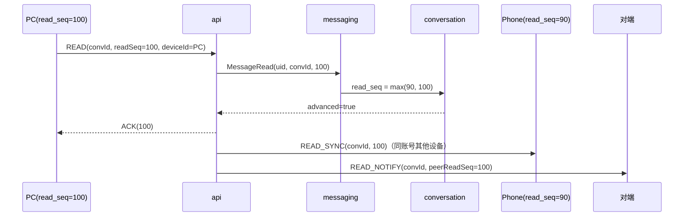

# 已读与未读调研：口径、群已读与万人群成本

> 关联 issue：<https://github.com/BanTanger/im-whale-shark/issues/110>
> 基线：`docs/architecture/im-v2-architecture.md`（`rewrite/v2`，1020 行，16 节）
> 分支：`research/unread-receipt-survey`（只做调研，永不合并）
> 日期：2026-10-29

**调研边界**：本文只回答「未读该存什么、群已读该不该做、做了要付多少成本」，不写 Java / proto / DDL 实现。所有数量级都基于显式假设推导，假设写在 §2.6；厂商结论都给了可点开的 URL，抓不到正文的按「未取得原文」标注，不当作已证实。

---

## 0. 结论先行

1. **未读与已读必须分开建模。** 未读是「用户 × 会话」的一个数，要求 O(1) 读取；群已读是「用户 × 消息」的布尔/时间，要求逐条精确。没有一种结构能同时把两者做到最优：
   - **水位（`read_seq`）** 适合做未读的主真相：发送时不写，读时写一次，天然支持多端 `max` 合并。
   - **计数** 适合做会话列表/总角标的派生投影，不适合做真相：每来一条消息要给 N 个成员各写一次。
   - **位图** 不是「未读口径」，而是「逐条已读」的存储形态；拿它算未读要扫消息，成本比水位高一个量级。

2. **万人群（N=10,000，峰值 50 msg/s）的写放大：**

   | 方案 | 发送时写/条 | 全员立即读最坏写 | 单条消息存储 | 万人群日增（满负荷） |
   |---|---|---|---|---|
   | 计数 | **10⁴ 行** | 5×10⁵ 行/s | 0（固定 640 KB/会话） | 0 增量（但写入 2.76 TB/天） |
   | 水位 | **0** | 2×10⁴ 行/s（500 ms 合并） | 0（固定 640 KB/会话） | 0 增量（写入 110.6 GB/天） |
   | 位图（每消息） | 0（首读分配 1.25 KB） | 5×10⁵ bit 写/s | **1,250 B** | **5.4 GB/天**（432 万个键/天） |
   | 每人一行 | 0（首读插入） | 5×10⁵ 行/s | **320 KB**（全员） | **1.38 TB/天** |

3. **基线 §2.4「已送达 N 人只能是估算」不成立**（作为技术必然性）。累计 ACK 的 `delivered_seq` 可以精确计数：2,000 在线、500 ms 上报一次，只有 4×10³ 次写/s/群，比「每条消息给 1 万人各发一次 ACK」低约 **125 倍**。真正的限制是「离线成员上线前不可知」和「查询是 O(N)」，不是「只能估算」。详见 §4。

4. **业界群已读全部有硬上限，没有一家支持万人群逐条名单：** 腾讯云 IM 200 人、环信 200 人 + 3 天、融云 3000 人、钉钉超过 1000 人不显示（二手口径）、飞书开放接口 7 天 + 50 QPS、微信完全不做已读。详见 §3。

5. **多端未读合并用 `read_seq = max(...)`**：幂等、可交换、可结合，重复/乱序上报天然安全。计数方案不能做减法，必须「置零」或由水位重算，否则双端同时清零会把未读减成负数。详见 §5。

6. **与基线冲突 6 处**（§7）：2 处正确性问题（未读算术、群已读 O(N) 聚合）、2 处论证问题（逐条名单的写放大、送达只能估算）、1 处事实问题（「业界不做名单」）、1 处多端缺口（READ 不回推同账号其他设备）。

---

## 1. 三个概念先分开

| 概念 | 主体与粒度 | 典型值 | 典型查询 | 它回答不了什么 |
|---|---|---|---|---|
| **未读** | 用户 × 会话 | 一个整数（可封顶 99+） | 会话列表红点、App 角标 | 谁读了某条消息 |
| **已读** | 用户 × 消息 | 布尔 + 首次已读时间 | 「N 人已读」、已读/未读名单 | 这个会话总共还有多少未读 |
| **送达** | 用户 × 设备 × 消息 | 布尔或每成员水位 | 「已送达 N 人」 | 用户是否真的看了 |

三个语义不能互换：

- **送达 ≠ 已读。** 消息推到设备只证明链路通，不证明人看了；反之用户看了旧消息也不代表新消息送达。
- **已读 N ≠ 未读 N。** 「已读 N」的分母是「发送时的应读成员」，要排除发送者、后入群者、已退群者；「未读」的分母是「当前成员」，且要排除免打扰会话。
- **前缀语义 ≠ 任意读。** 水位只能表达「读到第几条为止」，即读到 100 就认为 1–100 都读过；用户跳读第 101 条而没读第 100 条时，水位无法表达。群回执的「N 人已读」通常接受前缀语义；「谁读了第 101 条」不接受。

> 这条区分是后面所有成本对比的前提。把「未读」做成位图、或把「已读名单」做成水位，都会在某个查询上退化成全表扫描。

---

## 2. 三种未读口径 + 一种回执形态

### 2.1 计数（counter）

**机制**：每个 `(conv, uid)` 存一个整数。消息落库后，对每个应读成员 `+1`；用户读到时置 0（或减去已读条数）。

**写放大**：与消息率线性相关，且与「有多少人真的读」无关——只要消息发出，N 个成员就得各写一次。万人群、50 msg/s 就是 **5×10⁵ 次更新/s**。可以在网关侧按 500 ms 合并「本窗口 +k」，把在线成员的写降到 N/窗口；但离线成员没有连接可合并，要么落 N 行，要么等登录时用消息时间线重算（那就不叫计数了）。

**读成本**：会话列表 O(1)/会话，总角标 O(1)（另有汇总行）。

**失效模式**：

- 事件丢失/重复 → 计数漂移；必须有对账（用 `last_seq - read_seq` 回算）。
- 撤回、系统提示、定向消息占序号但不该计数 → 要维护「可计消息」规则，否则数字偏大。
- 多端并发清零 → 减法不幂等，容易减成负数。

**适用**：会话数很多、需要「总未读」快速聚合；或作为水位的异步投影，不放在主链路（基线 §6.5 已经这么写）。

### 2.2 水位（read_seq / watermark）

**机制**：每个 `(conv, uid)` 存「已读到哪个序号」。未读 = `last_seq − read_seq`（或按可计序号折算）。发送消息时不写任何成员状态，只有用户上报 READ 时才推进。

**写放大**：只与「读事件」相关。全员立即读的最坏情况下，10,000 人 × 2 次/s（500 ms 合并）= **2×10⁴ 次/s**；只有 2,000 在线时是 4×10³ 次/s。相比计数的 5×10⁵/s，低 1–2 个数量级。

**读成本**：未读 O(1)。但「某条消息已读 N 人」需要 `count(read_seq ≥ msg.seq)`，是 **O(N)=10⁴ 行/次** 的聚合（详见 §7 C2）。

**精确性**：

- 前缀语义下精确：读到 100 就认为 1–100 都读过。
- **序号有空洞时不精确**：基线 §7.1/§8.3 明确 `sequence` 允许空洞（Redis 号段进程重启丢未用完的号），§6.7 撤回又追加一条占号消息。`last_seq − read_seq` 会把空洞和不该计的消息算进未读。要么接受近似（99+ 场景够用），要么给每条消息维护「可计序号」的折算值。
- 无法表达跳读；无法给出「某条消息的首次已读时间」。

### 2.3 位图（bitmap）

位图有两个方向，**总比特数相同**（消息数 × 成员数），只是查询模式不同：

- **按消息存（每消息 N bit）**：`read:msg:{msgId}`，读一条消息就把自己的 bit 置 1。`BITCOUNT` 得到「已读 N」，`GETBIT` 得到「某人读没读」。这是群回执的标准形态。
- **按成员存（每成员 M bit）**：`read:conv:{convId}:{uid}`，第 i 位表示第 i 条消息读没读。可表达跳读，但单成员查询是 O(M/64)。

**成本**（N=10,000）：

- 每条消息 10,000 bit = **1,250 B**。
- 50 msg/s 满负荷：62.5 KB/s → **5.4 GB/天/群**；432 万个键/天。
- 全员立即读：5×10⁵ 次 bit 写/s。Redis `SETBIT` 是 O(1) 且幂等；落到数据库是 1.25 KB 页的读改写，**必须先在内存合并**，否则每个 bit 触发一次 1.25 KB 页写，物理写放大 10⁴ 倍。

**读成本**：

- 「已读 N」：1,250 B popcount ≈ **157 个 64 位字**，内存里 1–10 µs。
- 「未读」：按消息存要扫水位之后的全部消息（M 条）；按成员存要扫 M/64 个字。都不适合会话列表。

**结论**：位图是「逐条已读」的正确答案，不是「未读」的替代品。把它当未读口径，等于用 O(M) 换 O(1)。

### 2.4 每人一行（receipt row）

**机制**：`(msg_id, uid)` 一行，读到就插入。可带首次已读时间、设备 ID。

**成本**：全员已读时每条消息 **10,000 行 × 32 B = 320 KB**；50 msg/s → **1.38 TB/天/群**，432 亿行/天。只有 5% 成员读时降到 69 GB/天，仍然不是万人群能承受的量级。

**读成本**：`count(*)` 得到已读 N，按 `(msg_id, read_at)` 分页拿名单，是最灵活的形态。52im 的拆解文章把它列为「思路 1」，并指出 640 人群 1024 条消息就要 2.5–5 MB/天（[52im thread-3054](http://www.52im.net/thread-3054-1-1.html)）。

### 2.5 对比表（N=10,000，λ=50 msg/s）

> 「全员立即读」是最坏上界，用来比较方案的**结构成本**；真实读取率通常远低于 100%，但计数的成本与读取率无关，这是它和另外三者的本质差异。

| 维度 | 计数 | 水位 | 位图（每消息） | 每人一行 |
|---|---|---|---|---|
| 发送时写/条 | 10⁴ 行 | **0** | 0（首读分配 1.25 KB） | 0（首读插入） |
| 全员立即读写 | 5×10⁵ 行/s | **2×10⁴ 行/s**（500 ms 合并；在线 2k 时 4×10³） | 5×10⁵ bit/s | 5×10⁵ 行/s |
| 单条消息存储 | 0 | 0 | **1,250 B** | **320 KB** |
| 万人群日增（满负荷） | 0 增量，写 2.76 TB/天 | 0 增量，写 110.6 GB/天 | **5.4 GB/天** | **1.38 TB/天** |
| 未读数读取 | **O(1)** | **O(1)** 算术 | O(消息数) 或另存水位 | 需另存计数/扫行 |
| 「已读 N」读取 | 不支持 | O(N)=10⁴ 行/次 | **popcount 157 字** | O(1) count |
| 「已读名单」 | 不支持 | O(N) 扫描 | O(N/64 + k) | O(k) 索引分页 |
| 语义精确性 | 事件不丢/不重时精确 | 前缀精确；有空洞则近似 | 逐条精确 | 逐条精确 |
| 主要瓶颈 | 写吞吐、漂移 | 读聚合、空洞 | 内存/键数、页写放大 | 存储、行数 |

**一句话选型**：

- 未读真相：**水位**；
- 总角标/会话列表：**水位现算 O(C)**，或异步计数投影；
- 小群逐条回执：**位图 + TTL**；
- 万人群逐条回执：**不做**（业界也不做，见 §3）。

### 2.6 数量级怎么来的

**假设**（写死在全文，换参数按比例缩放）：

- N = 10,000 成员；λ = 50 msg/s（基线 §2.1 的万人群上限）；
- 在线比例 20% = 2,000；ACK/READ 合并窗口 500 ms（基线 §6.4 的合并窗口）；
- 行宽：计数/水位行 64 B（含主键与版本开销），回执行 32 B；
- 位图：N/8 = 1,250 B；
- 一天按 86,400 s。

**推导**：

- 计数：10,000 × 50 = 5×10⁵ 行/s；×64 B = 32 MB/s；×86,400 = **2.76 TB/天写入**。
- 水位（全员读、500 ms 合并）：10,000 × 2 = 2×10⁴ 行/s；×64 B = 1.28 MB/s；= **110.6 GB/天写入**。2,000 在线时是 4×10³ 行/s、22.1 GB/天。
- 位图：1,250 B × 50 × 86,400 = **5.4 GB/天**；键数 50 × 86,400 = **432 万/天**。
- 每人一行：10,000 × 32 B = 320 KB/条；×50 × 86,400 = **1.38 TB/天**；行数 4.32×10¹⁰/天。
- 已读聚合：10⁴ 行/次；若发送方对每条消息都查（50 次/s），就是 5×10⁵ 行读/s/群。

**与 52im 测算的交叉验证**：该文用 640 人、1024 条/天算出位图 2.5 KB–22.5 KB，而 ID 列表方案是 2.5–5 MB。**原文把「640/32 = 20 个 32 位字」写成了「20 字节」，少算 4 倍**：640 bit 实际是 80 B，1024 条上限是 82 KB（不是 22.5 KB）。修正后位图仍比 ID 列表小 **30–60 倍**，结论方向不变，但引用时不要直接抄 22.5 KB 这个数。来源：[52im thread-3054](http://www.52im.net/thread-3054-1-1.html)。

### 2.7 一个容易忽略的对称性

按消息存位图（M 条 × N bit）和按成员存位图（N 人 × M bit）**总比特数完全一样**，都是 `M×N/8`：

- 万人群、50 msg/s、一天 432 万条 → 10,000 × 4.32×10⁶ / 8 = **5.4 GB/天**，与方向无关。
- 7 天 TTL → **37.8 GB/群**；1,000 个这样的活跃群 → **37.8 TB**。

所以「位图省空间」只在**小群**或**短窗口**成立；万人群 + 7 天保留，省不下来。真正省的是「只对需要回执的消息建位图」，而不是「所有消息都建」。

### 2.8 读写扩散的取舍

消息本体和读状态是两套扩散，不要混在一起算：

| 对象 | 形态 | 扩散方向 | 成本公式 |
|---|---|---|---|
| 消息本体 | 时间线存一份，按 `conv_id` 分片 | **读扩散**（客户端按 seq 拉） | 存储 ∝ 消息数；投递 ∝ 在线连接数 |
| 未读（计数） | 每成员一个整数，消息落库后 +1 | **写扩散** | 写 ∝ N × λ |
| 未读（水位） | 每成员一个 `read_seq`，读时推进 | **读扩散**（查询时算） | 写 ∝ 读事件；查询 ∝ N × Q |
| 群已读（位图） | 每消息 N bit，读时置位 | **写扩散**（按读取事件） | 写 ∝ 读事件；存储 ∝ M × N / 8 |

把两组乘积放在一起，选型判据就很直接：

- 写侧：`N × λ`。万人群 50 msg/s = **5×10⁵/s**，这是计数和「每人一行」的固定底噪。
- 读侧：`N × Q`，Q 是「每秒查询已读人数的次数」。如果只有发送方偶尔点开回执面板，Q ≪ λ，那么水位聚合（O(N) 一次）比每消息位图更便宜；如果每条消息都要实时显示「N 人已读」（Q ≈ λ），位图把单次查询降到 157 字，反而更便宜。
- 所以「水位 vs 位图」不是绝对优劣，而是 **Q/λ 的比值**：Q/λ < 1 时水位聚合够用；Q/λ ≥ 1 且 N 不大时上位图；N 到万人、λ 到 50/s 时，两边都贵，正确做法是**不做逐条**（§3.3）。
- 基线 §6.3 的「大群广播」是**消息投递**的写扩散（牺牲带宽换延迟），与读状态无关；不要因为它已经做了广播，就认为读状态也该写扩散。

---

## 3. 业界实践：微信 / 钉钉 / 飞书 / 环信 / 融云 / 腾讯云

### 3.1 汇总表

| 厂商 | 未读口径（公开证据） | 群已读 | 规模/时间限制 | 证据 |
|---|---|---|---|---|
| **微信** | 会话列表有红点/数字；服务端实现未公开 | **不做** | 产品明确不提供 | [微信派声明（澎湃转载）](https://www.thepaper.cn/newsDetail_forward_31327158) |
| **钉钉** | 未见公开实现；产品有未读/已读统计 | 有：已读人数 + 已读/未读名单 | 超过 1000 人不显示（二手口径）；官方 API 仅覆盖企业群/机器人 | [getReadList](https://open.dingtalk.com/document/orgapp/queries-the-list-of-people-who-have-read-a-group)、[机器人查询](https://open.dingtalk.com/document/orgapp/chatbot-queries-the-read-status-of-a-message) |
| **飞书** | 未公开 | 有：消息右侧圆环显示已读比例；开放接口可查已读名单 | 开放接口：仅机器人自己发的消息、7 天内、50 QPS、单条查询 | [read_users API](https://open.feishu.cn/document/server-docs/im-v1/message/read_users)、[帮助中心](https://www.feishu.cn/hc/zh-CN/articles/360045201453-%E6%9F%A5%E7%9C%8B%E6%B6%88%E6%81%AF%E7%9A%84%E5%8F%91%E9%80%81%E5%92%8C%E9%98%85%E8%AF%BB%E7%8A%B6%E6%80%81) |
| **环信** | 服务端会话未读数，清零后同步其他设备 | 有：逐条已读回执 + 已读人数 + 分页名单 | **群 ≤200 人 / 回执 3 天**；群聊不支持送达回执 | [消息回执](https://doc.easemob.com/document/ios/message_receipt.html)、[会话未读数](https://doc.easemob.com/document/ios/conversation_unread.html) |
| **融云** | 有会话未读数/总未读 API；服务端实现未公开 | 有：V5 逐条已读（readCount/unreadCount/totalCount + 分页名单） | **群 ≤3000 人**；旧版群回执需发送方手动发起 | [逐条已读 V5](https://docs.rongcloud.cn/android-imlib/message/read-receipt-v5)、[群聊消息回执](https://docs.rongcloud.cn/web-imlib/message/receipt-group) |
| **腾讯云 IM** | 服务端 `unreadCount` + `getTotalUnreadMessageCount` | 有：REST 批量查 `ReadNum`/`UnreadNum`，可分页拉名单 | **群 ≤200 人**；REST 200 次/s；旗舰版/企业版 + 控制台开关 | [已读回执概述](https://trtc.io/zh/document/48022)、[REST 拉取](https://trtc.io/zh/document/49439)、[会话未读数](https://trtc.io/zh/document/48320) |

### 3.2 逐家解读

#### 微信：产品层直接否决，不给技术讨论空间

2025-08-07 微信官方公众号「微信派」发文《为什么微信没有已读功能？》，明确「从一开始就没有已读功能，以后也不会有」；腾讯公关总监张军同步表态「已读会增加接收者的心理负担和社交压力」。澎湃新闻转载保留了原文与截图：[链接](https://www.thepaper.cn/newsDetail_forward_31327158)。

技术含义：

- 微信**没有**逐条已读回执，也没有「群已读 N」；因此「微信群怎么实现已读」这个问题在微信体系内不存在。
- 微信会话未读数的服务端实现没有公开文档；无法从公开资料判定它是客户端计算还是服务端计数。本文**不把微信作为未读存储形态的证据**，只作为「产品可以选择不做」的证据。
- 52im 的实现拆解也把微信列为「为了隐私不提供在线状态/已读回执」的代表：[52im thread-1611](http://www.52im.net/thread-1611-1-1.html)。

#### 钉钉：有已读名单，但规模上限卡在产品层

钉钉企业群的已读能力体现在两个官方 API：

- `GET /chat/getReadList`：按 `messageId` 分页查已读人员列表，`size` 最大 100，且不能超过群总人数。文档同时标注：**该接口 2022-09-23 起迁入历史文档，不再支持新应用接入**。 [来源](https://open.dingtalk.com/document/orgapp/queries-the-list-of-people-who-have-read-a-group)
- `POST /v1.0/robot/groupMessages/query`：企业机器人群消息已读状态，返回 `readUserIds`，`maxResults` 最大 200，游标分页。 [来源](https://open.dingtalk.com/document/orgapp/chatbot-queries-the-read-status-of-a-message)

产品层的规模限制没有在开放平台文档里写死，但多个帮助类问答一致表述：**1000 人以下的群显示已读/未读统计，超过 1000 人不显示（企业认证的全员群扩到 3000 人除外）；合并转发的消息不支持已读统计**。这属于二手来源，标注为「未取得官方原文」，仅用于说明「上限存在」：[ZOL 问答](https://ask.zol.com.cn/x/16215430.html)。

#### 飞书：逐条回执 + 7 天窗口 + 50 QPS

飞书帮助中心的产品描述是「消息右侧圆环，绿色占比 = 已读用户占会话全部用户的比例」，即**逐条消息的已读比例**：[帮助中心](https://www.feishu.cn/hc/zh-CN/articles/360045201453-%E6%9F%A5%E7%9C%8B%E6%B6%88%E6%81%AF%E7%9A%84%E5%8F%91%E9%80%81%E5%92%8C%E9%98%85%E8%AF%BB%E7%8A%B6%E6%80%81)。

开放接口 `GET /open-apis/im/v1/messages/:message_id/read_users` 的限制非常具体：

- 只返回**已读**用户，不返回未读用户；
- 只能查**机器人自己发送的**、发送时间不超过 **7 天**的消息；
- 一次一条，不支持批量；频率 **1000 次/分钟、50 次/秒**；分页 `page_size` 最大 100；
- 返回每个已读用户的 `timestamp`（毫秒）。

来源：[read_users API](https://open.feishu.cn/document/server-docs/im-v1/message/read_users)。

**解读**：返回「用户 + 已读时间」意味着至少对近 7 天的回执消息，飞书能按「消息 × 用户」给出已读记录（行或等价索引，**这是从接口行为反推，官方未说明存储形态**），而不是只存一个水位。7 天是成本/合规的截断点，50 QPS 是查询侧的保护。飞书没有公开群人数与回执的关系，不能据此推断它支持万人群。

#### 环信：未读是服务端计数，群回执硬上限 200 人

- **未读数**：`clearConversationUnreadMessageCount` 把指定会话未读置 0，并**同步到当前账号的其他设备**；`clearAllConversationUnreadMessageCount` 清全部。文档明确「清零不会通知对端，也不会触发已读回执」，两者是独立操作。 [来源](https://doc.easemob.com/document/ios/conversation_unread.html)
- **群回执**：群聊支持消息已读回执，不支持送达回执；已读回执有效期 **3 天**；**群规模上限 200 人，超过 200 人后群消息不返回已读回执，该上限目前无法提升**；默认只有发送方能看已读人数。 [来源](https://doc.easemob.com/document/ios/message_receipt.html)
- **会话已读回执**：群聊的会话级回执只用于清空服务端未读数，不会给发送方推 `onChannelMessage`。 [来源](https://doc.easemob.com/v4/web/conversation_receipt.html)

**解读**：环信把「未读」（会话级计数）和「已读回执」（消息级）彻底分成两套；群回执的 200 人上限就是成本边界，官方直接写明「无法提升」。

#### 融云：V5 逐条已读，3000 人上限

- V5「逐条消息已读」从 SDK 5.20.0 起支持，`needReceipt=true` 的消息才记录；`getMessageReadReceiptInfoV5` 返回 `readCount` / `unreadCount` / `totalCount`，`getMessagesReadReceiptUsersByPageV5` 分页拉已读/未读用户，支持 `ReadStatus.UNREAD` 过滤。 [来源](https://docs.rongcloud.cn/android-imlib/message/read-receipt-v5)
- **群成员超过 3000 人时，不支持群聊逐条消息已读**；该功能依赖「单群聊消息云存储」，仅旗舰版/尊享版可开。 [同上]
- 旧版「群聊消息回执」需要发送方手动发起请求（`sendReadReceiptRequest`），接收方响应后才回传；官方建议「不要对每条消息自动请求，避免回执消息量影响体验」。 [来源](https://docs.rongcloud.cn/web-imlib/message/receipt-group)

**解读**：融云把「逐条已读」做成付费能力 + 3000 人上限 + 发送方按需触发，三个手段都在压回执量。

#### 腾讯云 IM：未读是服务端计数，群回执 200 人

- **未读**：会话对象有 `unreadCount`，SDK 提供 `getTotalUnreadMessageCount` 和过滤后的未读总数；未读总数会减去免打扰会话。 [来源](https://trtc.io/zh/document/48320)
- **群回执**：`needReadReceipt=true` 的消息，接收方调用 `sendMessageReadReceipts`，发送方监听 `onRecvMessageReadReceipts` 拿 `readCount` / `unreadCount`；**群已读回执群内最大 200 人**，需专业版/企业版并在控制台开启。 [来源](https://trtc.io/zh/document/48022)
- **REST**：`get_group_msg_receipt` 支持按 `MsgSeqList` 批量查 `ReadNum`/`UnreadNum`，最高 **200 次/s**；另有接口分页拉已读/未读成员列表。 [来源](https://trtc.io/zh/document/49439)

**解读**：REST 批量查「每条消息的已读/未读数」说明腾讯云在服务端保存了逐条回执的聚合值（至少是 `ReadNum`/`UnreadNum`），而不是让调用方扫成员水位。200 人上限与环信一致。

### 3.3 规律：上限不是拍脑袋，是成本边界

把六家的公开限制排在一起：

| 厂商 | 群回执上限 | 时间窗口 | 触发方式 |
|---|---|---|---|
| 腾讯云 IM | 200 人 | 未公开 | 消息级 `needReadReceipt` |
| 环信 | 200 人（无法提升） | 3 天 | 消息级 `isNeedReadReceipt` |
| 钉钉 | ~1000 人（二手） | 未公开 | 消息级统计 |
| 融云 | 3000 人 | 未公开 | 消息级 `needReceipt` / 旧版手动请求 |
| 飞书 | 未公开（API 仅机器人） | 7 天 | 消息级 |
| 微信 | 不做 | — | — |

三个共同点：

1. **没有一家对万人群开放逐条已读名单。** 上限落在 200–3000 人，正好对应「每人一行/位图」的成本从几十 MB 涨到几 GB 的区间。
2. **都用「按需触发」而不是「每条消息自动回执」。** 融云明确建议手动请求；腾讯云/环信用 `needReadReceipt` 标志；飞书只对机器人消息开放 API。
3. **都有时间窗口。** 环信 3 天、飞书 7 天；本质是给回执数据设 TTL，把它当「热数据」而不是永久审计数据。

这三点直接支持基线「10k 群不做逐条名单」的结论，但**不能支持「业界不做」这个理由**——业界做，只是有上限。

---

## 4. 核验：「已送达 N 人只能是估算」成立吗？

### 4.1 命题与章节号

issue 写的是「基线 §6.7」，但基线 §6.7 是**撤回**；这句话实际在 **§2.4「大群妥协」表格的「送达语义」行**：

> 群消息不逐成员追送达确认，"已送达 N 人"只能是估算 | 每个成员一条下行 ACK，万人群一条消息 1 万次回执

它与 §6.5「已读与未读」相邻，但不是同一节。本文按实际章节引用，避免后续讨论找错位置。

### 4.2 先把「送达」拆成三种定义

| 定义 | 服务端能观测到什么 | 需要客户端 ACK 吗 | 精确性 |
|---|---|---|---|
| **D1 已写出到连接** | 网关 `channel.writeAndFlush` 成功 | 不需要 | 对「在线且写出成功」精确；不证明客户端收到 |
| **D2 客户端已收** | 客户端累计 ACK 到某个 seq | 需要（可批量/累计） | 对「已 ACK 的成员」精确 |
| **D3 用户已看** | READ 上报 | 需要 | 这是「已读」，不是「送达」 |

基线说的「送达」如果指 D1，其实**不需要任何逐成员 ACK**：网关在投递时就能数出「本次写成功了多少个连接」，这是 O(1) 的计数器，不是估算。如果指 D2，则需要客户端 ACK，但**不需要每条消息 1 万次 ACK**——累计 ACK 就够了。

### 4.3 精确计算的三条路

**方案 A：每成员 `delivered_seq`（累计 ACK）**

- 状态：每个 `(conv, uid)` 一个「已连续收到的最大 seq」，10,000 × 16 B = **160 KB/群**。
- 客户端每 500 ms（或每 K 条）上报一次 `deliveredSeq = 已连续收到的最大 seq`；服务端取 `max`。
- 「消息 M 已送达 N 人」= `count(delivered_seq ≥ M.seq)`，排除发送者、后入群者、已退群者。
- 精确性：对「已上报的在线成员」精确；离线成员没上报，就是「未送达/未知」，这是定义问题，不是估算。
- 查询：O(N)=10⁴ 行/次；用按 seq 分桶的 Fenwick 树可降到 O(log B)≈14 次操作，或对每条消息维护一个送达位图（popcount 157 字）。

**方案 B：每消息送达位图**

- 每条消息 N bit = 1,250 B；收到 ACK 置位；`BITCOUNT` 得到精确人数。
- 写：每次 ACK 1 bit；全员立即 ACK 时 5×10⁵ bit/s。
- 存储：5.4 GB/天/群（与已读位图同量级）。

**方案 C：每消息每成员一行**

- 精确但最贵：320 KB/条、1.38 TB/天/群。不推荐。

### 4.4 成本对比

| 做法 | 状态 | 写成本（2,000 在线 / 10k 群） | 存储 | 查询 | 结论 |
|---|---|---|---|---|---|
| 每消息逐成员 ACK（基线假设） | 无 | 10,000 × 50 = **5×10⁵ 次/s** | 位图 1.25 KB/条或行 32 B | popcount/count | 基线否定的正是这个 |
| **累计 ACK（`delivered_seq`）** | 160 KB/群 | 2,000 × 2 = **4×10³ 次/s** | 160 KB | O(N) 或 O(log B) | **比逐消息 ACK 低 125×** |
| 每消息送达位图 | 1.25 KB/条 | 5×10⁵ bit/s | 5.4 GB/天 | popcount 157 字 | 精确但存储贵 |
| D1 网关写成功计数 | 0 | 0（投递时顺带） | 0 | O(1) | 只证明「写出」，不证明「收到」 |
| 纯估算（在线数 × 到达率） | 0 | 0 | 0 | O(1) | 不精确 |

**关键数字**：逐消息 ACK 是 `N × λ = 5×10⁵/s`；累计 ACK 是 `在线成员 × 上报频率 = 2,000 × 2 = 4×10³/s`。前者随「消息率 × 成员数」增长，后者只随「在线成员数」增长，与消息率无关。这是 125 倍的差距，不是 10%。

### 4.5 结论

- **作为技术命题，「已送达 N 只能是估算」不成立。** 精确计算有三种做法，其中累计 ACK 的写成本完全可接受（4×10³ 次/s/群），存储只有 160 KB/群。
- **作为产品取舍，它可以是成立的**：如果产品只愿意维护「读水位」、不愿维护「送达水位」，那送达只能估算。但这是**选择**，不是**限制**，基线应把措辞从「只能是」改成「我们选择不维护逐成员送达状态」。
- **真正无法精确的只有一种情况**：离线成员在重新上线之前，服务端不知道消息未来会不会送达。任何方案都只能给出「已送达（在线）」或「待上线后确认」。
- **送达 ≠ 已读**：即使做到 D2 精确，也不能把「已送达 N」展示成「已读 N」。已读要用 READ 水位/回执，和送达是两条链路。

---

## 5. 多端（PC + 手机）未读怎么合并

### 5.1 状态模型：一个 `(uid, conv)` 一个水位，合并规则是 `max`

```
read_state(uid, conv) = max(所有设备上报的 read_seq)
```

`max` 是 **幂等、可交换、可结合** 的：

- 重复上报：结果不变；
- 乱序上报（先 100 后 90）：90 被忽略；
- 两台设备并发（PC 100 / 手机 90）：结果是 100；
- 离线设备重新登录：拉一次服务端 `read_seq`，与本地取 `max` 即可。

这等价于一个 **Max-Register / G-Counter 的变体**，不需要分布式锁，也不需要版本向量。

### 5.2 事件流



三个要点：

1. **只有推进时才发事件**（`advanced=true`），重复/回退不产生下行，避免风暴。
2. **同账号其他设备也要收**（`READ_SYNC`）。基线 §6.5 只画了给对端的 `READ_NOTIFY`，没有同账号自同步；这是多端红点不消的直接原因（§7 C6）。
3. **`deviceId` 只用于回显抑制和审计**，不参与合并；合并只看 `readSeq`。

### 5.3 场景表

| 场景 | 水位方案 | 计数方案 | 位图/行方案 |
|---|---|---|---|
| PC 读到 100，手机读到 90 | `max=100`，手机下次同步清除 | 两次「清零」→ 若做减法会变负；必须置 0 | 无影响；bit 已置位 |
| 同一 READ 重复上报 | 幂等，无变化 | 需要事件 ID 去重，否则重复减 | `SETBIT` 幂等 |
| 乱序（100 后到 90） | 90 被忽略 | 可能把计数减多 | bit 无序，无影响 |
| 跨会话并行（PC 读 A，手机读 B） | 两行独立，无冲突 | 两行独立 | 两个键独立 |
| 手机离线，PC 已读 | 手机登录拉 `read_seq` | 手机本地计数可能过期，需服务端为准 | 手机按需拉回执 |
| 新消息 101 与 READ(100) 并发 | 101 仍未读，正确 | 清零与 +1 竞争，可能丢 1 | 101 的 bit 未置，正确 |
| 免打扰会话 | 仍存水位，但总角标排除 | 同 | 同 |
| 读时间 | 只能记「水位推进时间」，不是每条消息的已读时间 | 无 | 可记每用户首次已读时间（取 min） |
| 跳读第 101 条、未读第 100 条 | 无法表达（前缀语义） | 可表达（按条减） | 可表达（按消息置位） |

### 5.4 三种方案的多端差异

- **水位**：多端合并最自然；代价是无法表达跳读、无法给逐条已读时间。
- **计数**：多端最危险。不能做「减 1」，只能「置 0」或「按服务端水位重算」；否则双端各清一次就变负。工程上通常把计数降级为「水位的异步投影」，读时以水位为准。
- **位图/行**：多端最安全（置位/插入都幂等），但存储最贵；且「已读 N」应按**用户**去重，不是按设备——同一用户 PC + 手机都读，不能算 2 人。

**一条硬规则**：**未读的真相只存一份，按 `(uid, conv)` 存**；设备本地只缓存「滚动位置」用于恢复阅读位置，不用它算未读。否则多端一定会出现「手机清了、PC 还有」或「两端各减一次」。

---

## 6. 给基线的建议（只到契约层，不写实现）

### 6.1 推荐组合

| 需求 | 推荐 | 理由 |
|---|---|---|
| 每会话未读 | **水位 `read_seq`** + 可计序号折算 | O(1) 读、发送零写、多端 max 合并 |
| 会话列表总角标 | 水位现算（O(会话数)）或异步计数投影 | 不把计数放主链路 |
| 总未读（跨会话） | 可选计数投影，消费消息事件合并写 | 只有产品要「精确总角标」时才需要 |
| 群已读 N（≤500/1000 人） | **每消息位图 + 7 天 TTL** | popcount O(1)，写 1 bit/读 |
| 群已读 N（万人群） | **不做逐条名单**；只给「读到哪」或关闭 | 业界上限 200–3000，10k 超出一个数量级 |
| 已送达 N | 若要精确：**每成员 `delivered_seq` 累计 ACK**；否则明确标注「估算/仅在线」 | 4×10³ 写/s，比逐消息 ACK 低 125× |
| 多端 | `read_seq = max`；READ 回推同账号其他设备 | 幂等、无锁 |

### 6.2 群已读的开关阈值

建议按「成员数 × 消息率」设阈值，而不是只按成员数：

- **≤500 人**：默认开启逐条已读，位图 + 7 天 TTL；
- **500–3000 人**：默认关闭，管理员可按群开启（对齐融云 3000 上限）；
- **>3000 人**：不提供逐条名单，只提供「已读人数」聚合（若必须），且异步计算、允许延迟；
- **>10,000 人**：不提供任何逐条回执，只保留水位。

这条阈值与 §3.3 的业界上限一致，避免我们在 10k 群上做一个连腾讯云/环信都不做的功能。

### 6.3 需要补的契约（字段/事件，不是 DDL）

1. **可计序号**：每条消息除 `sequence` 外，记录「截至本条的可计消息数」；或在会话维度维护「seq → 可计序号」的稀疏映射。否则 `last_seq − read_seq` 在空洞/撤回/系统消息下不精确。
2. **`join_seq` 已有，补 `leave_seq`/`left_at`**：否则成员退群后删行，历史消息的「应读人数」会漂移，「已读 N」的分母变得不可复现。
3. **READ 事件带 `deviceId` + `clientEventId`**：`deviceId` 用于同账号回推与回显抑制，`clientEventId` 用于计数投影的幂等去重。
4. **`READ_SYNC` 下行**：同账号其他设备需要知道 `read_seq` 推进；只靠登录时拉取会有「在线设备红点不消」的窗口。
5. **回执 TTL**：位图/回执行必须有 3–7 天 TTL；不要当永久审计数据存。
6. **`delivered_seq`（可选）**：如果产品要「已送达 N」，按成员存累计 ACK 水位，不要按消息存 1 万条 ACK。
7. **免打扰口径**：总未读是否排除 `muted` 会话，服务端和客户端必须同一口径（腾讯云/环信都是服务端算总未读时排除）。

---

## 7. 与基线冲突（四段格式）

### C1 未读数算术在序号空洞下不精确

- **原方案**（§6.5）：`未读数 = last_sequence − read_sequence`，服务端不存计数。
- **新结论**：该公式只在「序号连续且每条序号都可计」时精确。基线 §7.1/§8.3 明确 `sequence` 允许空洞（Redis 号段重启丢号），§6.7 撤回又追加一条占号消息；因此实际未读会被高估。需要「可计序号」折算，或接受近似并明确写出来。
- **理由**：空洞来自号段分配（进程重启丢弃未用完的号）和系统消息/撤回；这些序号不该让红点 +1。只用水位做减法，无法区分「这条序号是消息」还是「这条序号是空洞」。
- **性能/成本差异**：每条消息多存 8 B 的可计序号，50 msg/s × 86,400 = 432 万条/天 → **34.6 MB/天/群**，相对消息正文可忽略；若改用「每成员计数投影」，万人群 5×10⁵ 次写/s、2.76 TB/天写入，代价高 3 个数量级。**推荐前者**。

### C2 群已读人数用 `conversation_member.read_sequence` 聚合，查询成本随消息率线性增长

- **原方案**（§6.5）：群聊「已读人数」在 `conversation_member.read_sequence` 上做聚合查询，不做每条消息的已读名单。
- **新结论**：聚合在语义上可精确（前缀语义），但每次查询是 O(N)=10⁴ 行；50 msg/s 下若发送方逐条查询，就是 **5×10⁵ 行读/s/群**，不可扩展。业界用「每消息回执聚合值/位图」把查询降到 O(N/64) 或 O(1)，并设 200–3000 人上限。
- **理由**：读放大的分母是「消息数 × 查询次数」，不是「成员数」；万人群 + 高频消息会把聚合查询打成全表扫描。位图把一条消息的已读人数变成 1,250 B 的 popcount（157 个 64 位字），查询成本降 2 个数量级。
- **性能/成本差异**：水位聚合 O(10⁴) 行/次；位图 1,250 B/条、5.4 GB/天/群、popcount≈157 字/次。若只按 5 s 异步聚合一次，读降到 2×10³ 行/s/群，但「已读 N」会延迟 5 s。两条路都比「逐条实时聚合」便宜。

### C3 「逐条名单 = 每条消息 × 成员数 的写放大」不准确

- **原方案**（§2.4）：只给水位与已读人数聚合，不给每条消息的已读名单；理由是「逐条名单 = 每条消息 × 成员数 的写放大」。
- **新结论**：这个等式只对「每人一行且预分配全部成员」成立。位图形态下，每条消息是 **1,250 B**，每次已读只写 **1 bit**；写放大是「每次已读 1 bit」，不是「每条消息 × 成员数 次写」。真正的成本是**存储/键数**（5.4 GB/天/群）和 TTL，不是 N 倍写。
- **理由**：位图按读取事件置位，未读成员不产生写；52im 的实测（640 人、1024 条/天）位图约 80 KB（原文误写 22.5 KB），ID 列表 2.5–5 MB，仍差 30–60 倍。把「行式预分配」的成本当成「所有回执形态」的成本，会误判位图不可行。
- **性能/成本差异**：行式 320 KB/条、1.38 TB/天（全员已读）；位图 1.25 KB/条、5.4 GB/天，**存储差 256 倍**；写次数同量级（每次读一次），但位图必须内存合并后落库，否则 1.25 KB 页读改写会把物理写放大 10⁴ 倍。

### C4 「已送达 N 人只能是估算」不成立

- **原方案**（§2.4「送达语义」行）：群消息不逐成员追送达确认，「已送达 N 人」只能是估算；代价是「每个成员一条下行 ACK，万人群一条消息 1 万次回执」。
- **新结论**：作为技术命题不成立。用每成员 `delivered_seq` 累计 ACK，可以精确算出「消息 M 已送达 N 人」；写成本只与在线成员数 × ACK 频率有关（2,000 × 2 = 4×10³ 次/s/群），与消息率无关，比逐消息 ACK 低 **125 倍**。**离线成员上线前不可知**、查询 O(N) 是真实限制，但不是「只能估算」。
- **理由**：ACK 可以是累计的（像 TCP 累积确认），客户端每 500 ms 上报「已连续收到的最大 seq」，服务端取 max；不需要每条消息给每个成员发一次 ACK。若「送达」定义为「网关写出成功」，更是零额外 ACK，投递时顺带计数即可。
- **性能/成本差异**：逐消息 ACK 5×10⁵ 次/s、位图 5.4 GB/天；累计 ACK 4×10³ 次/s、状态 160 KB/群；网关写成功计数 0 额外写、0 存储，但语义只到「写出」。三者按产品语义选，成本差 2–3 个数量级。

### C5 「业界不做逐条已读名单」与事实不符

- **原方案**（§2.4）：只给「读到哪」的水位与已读人数聚合，不给每条消息的已读名单；隐含理由是业界不做。
- **新结论**：钉钉、飞书、环信、融云、腾讯云都提供逐条已读名单（分页），只是都有硬上限/窗口：钉钉 >1000 人不显示、飞书 API 7 天 + 50 QPS、环信 200 人 + 3 天、融云 3000 人、腾讯云 200 人。**10k 群确实没有一家支持**，但「业界不做」是错的。
- **理由**：上限就是成本边界；厂商不是「不做」，而是「在 200–3000 人以上关掉或限窗」。微信是唯一从产品层完全否决的。
- **性能/成本差异**：200 人群位图 25 B/条、3,000 人群 375 B/条、10,000 人群 1,250 B/条；按 50 msg/s 满负荷，分别是 108 MB/天、1.62 GB/天、5.4 GB/天。10k 群比 200 人群贵 50 倍，且查询/存储都要单独分区。**基线的「10k 不做」结论可保留，理由应改成「业界在 200–3000 人以上即关闭/限窗，10k 超出一个数量级」**。

### C6 多端缺少同账号自同步

- **原方案**（§6.5 时序图）：`READ` 之后只给对端发 `READ_NOTIFY(convId, peerReadSeq)`，没有给同账号其他设备的事件。
- **新结论**：多端一致性要求 READ 事件回推同 uid 的其他 device（或登录时同步 `read_seq`），否则 PC 读完后手机红点不消。水位用 `max` 合并天然幂等；计数方案必须「置零/重算」，不能做减法。
- **理由**：环信明确「清空未读数会同步到当前账号的其他设备」，并提供多设备事件；腾讯云/融云也以服务端会话未读数为准。基线只画了对端通知，是时序图的缺口，不是实现细节。
- **性能/成本差异**：每个 READ 事件多 `N_device − 1` 条下行（通常 1–3 条），可忽略；登录同步多返回一个 `read_seq` 字段（8 B/会话）。计数方案若坚持减法，需要额外的事件去重表（`clientEventId`，保留 10 min），又是一份写放大。

---

## 8. 证据清单

| # | 来源 | 类型 | 关键结论 | 抓取状态 |
|---|---|---|---|---|
| E1 | [微信派声明（澎湃转载，2025-08-07）](https://www.thepaper.cn/newsDetail_forward_31327158) | 官方声明转述 | 微信永远不做已读 | 已取得正文 |
| E2 | [52im：IM 群聊消息的已读回执该怎么实现](http://www.52im.net/thread-1611-1-1.html) | 一线实现拆解 | 水位/回执表/批量 ACK/轮询的取舍；微信因隐私不做 | 已取得正文 |
| E3 | [52im：群聊已读未读的存储思路](http://www.52im.net/thread-3054-1-1.html) | 存储测算 | 位图 vs ID 列表；640 人/1024 条的量级 | 已取得正文（原文有 4× 单位错误，已在 §2.6 修正） |
| E4 | [飞书 read_users API](https://open.feishu.cn/document/server-docs/im-v1/message/read_users) | 厂商官方文档 | 逐条已读用户 + 时间；7 天；50 QPS；分页 100 | 已取得正文 |
| E5 | [飞书帮助：查看消息的发送和阅读状态](https://www.feishu.cn/hc/zh-CN/articles/360045201453-%E6%9F%A5%E7%9C%8B%E6%B6%88%E6%81%AF%E7%9A%84%E5%8F%91%E9%80%81%E5%92%8C%E9%98%85%E8%AF%BB%E7%8A%B6%E6%80%81) | 厂商官方文档 | 圆环显示已读比例 | 取得标题/摘要与部分正文（页面依赖 JS） |
| E6 | [钉钉 getReadList](https://open.dingtalk.com/document/orgapp/queries-the-list-of-people-who-have-read-a-group) | 厂商官方文档 | 按消息分页查已读人员；2022-09-23 起不接新应用 | 已取得正文 |
| E7 | [钉钉机器人查群消息已读](https://open.dingtalk.com/document/orgapp/chatbot-queries-the-read-status-of-a-message) | 厂商官方文档 | `readUserIds` 分页，页大小 200 | 已取得正文 |
| E8 | [环信消息回执](https://doc.easemob.com/document/ios/message_receipt.html) | 厂商官方文档 | 群回执 ≤200 人、3 天；群不支持送达回执 | 已取得正文 |
| E9 | [环信会话未读数](https://doc.easemob.com/document/ios/conversation_unread.html) | 厂商官方文档 | 服务端未读数清零；多设备同步 | 已取得正文 |
| E10 | [环信会话已读回执](https://doc.easemob.com/v4/web/conversation_receipt.html) | 厂商官方文档 | 群会话回执只清未读，不推发送方 | 已取得正文 |
| E11 | [融云逐条消息已读 V5](https://docs.rongcloud.cn/android-imlib/message/read-receipt-v5) | 厂商官方文档 | 群 >3000 人不支持；readCount/unreadCount/totalCount + 分页名单 | 已取得正文 |
| E12 | [融云群聊消息回执](https://docs.rongcloud.cn/web-imlib/message/receipt-group) | 厂商官方文档 | 发送方手动发起；建议不要每条自动请求 | 已取得正文 |
| E13 | [腾讯云已读回执概述（TRTC 镜像）](https://trtc.io/zh/document/48022) | 厂商官方文档 | 群回执 ≤200 人；需专业版/企业版 | 已取得正文 |
| E14 | [腾讯云 REST 拉取群回执（TRTC 镜像）](https://trtc.io/zh/document/49439) | 厂商官方文档 | 批量查 ReadNum/UnreadNum；200 次/s | 已取得正文 |
| E15 | [腾讯云会话未读数（TRTC 镜像）](https://trtc.io/zh/document/48320) | 厂商官方文档 | `unreadCount` + 总未读；免打扰排除 | 已取得正文 |
| E16 | [ZOL 问答：钉钉已读未读人数上限](https://ask.zol.com.cn/x/16215430.html) | 二手问答 | >1000 人不显示（企业全员群 3000 例外） | 已取得正文，**二手，未见官方原文** |
| E17 | [腾讯云 107478 群消息已读回执](https://cloud.tencent.com/document/product/269/107478) | 厂商官方文档 | 「群内最大人数为 200 人」 | **未取得正文**（JS 渲染）；已用同文 TRTC 镜像 E13 替代 |
| E18 | 微信未读的服务端实现 | — | 无公开文档 | **未取得原文**，本文不作证据 |

**来源优先级**：厂商官方文档（E4–E15、E17）> 一线实现拆解（E2、E3）> 官方声明转述（E1）> 二手问答（E16）。E16/E17/E18 已按「未取得原文/二手」标注，结论不单独依赖它们。

---

## 9. 未决问题（给主设计者拍板）

1. **产品要「已读人数」还是「已读名单」？** 只要人数，水位聚合 + 异步缓存就够；要名单，必须引入每消息位图/行，并接受上限与 TTL。
2. **「已送达 N」的产品语义是 D1（写出）、D2（客户端收到）还是 D3（用户已看）？** 三者成本差 2–3 个数量级；D1 可以零成本精确，D2 要累计 ACK，D3 就是已读。
3. **未读角标要精确到条，还是 99+ 就够？** 99+ 可以容忍水位空洞近似；精确到条必须补「可计序号」或计数投影。
4. **免打扰会话是否计入总未读？** 腾讯云/环信都在服务端算总未读时排除；基线目前没有写这条口径。
5. **退群成员的历史消息还展示已读状态吗？** 需要 `leave_seq` 或成员快照，否则「已读 N / 应读 N」的分母会随成员变动漂移。
6. **回执数据保留多久？** 环信 3 天、飞书 7 天；如果基线要做审计级永久保留，成本模型要按 PB 级重算，不能沿用本文的 7 天 TTL。
7. **万人群是否需要「管理员看已读人数」？** 如果只是群主/管理员看一个聚合数，可以异步算且允许延迟，不必做逐条名单。

---

## 附录：本文没有做的事

- 没有改基线文档；冲突只在 §7 记录，等主设计者决定是否回写。
- 没有写 Java / proto / DDL；§6.3 只列契约级字段，落地时再定类型与索引。
- 没有跑 mvn / 全量测试；本文是调研，不是实现。
- 没有把「微信未读实现」当成已证实事实；公开资料不足，已标注 E18。
